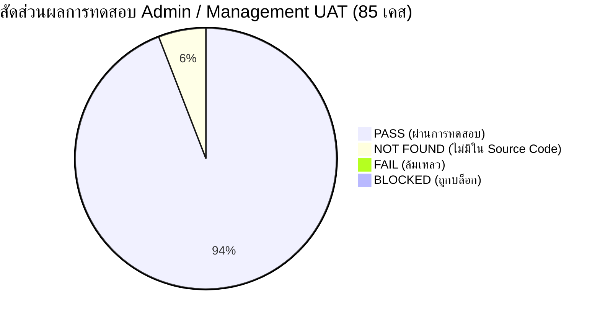
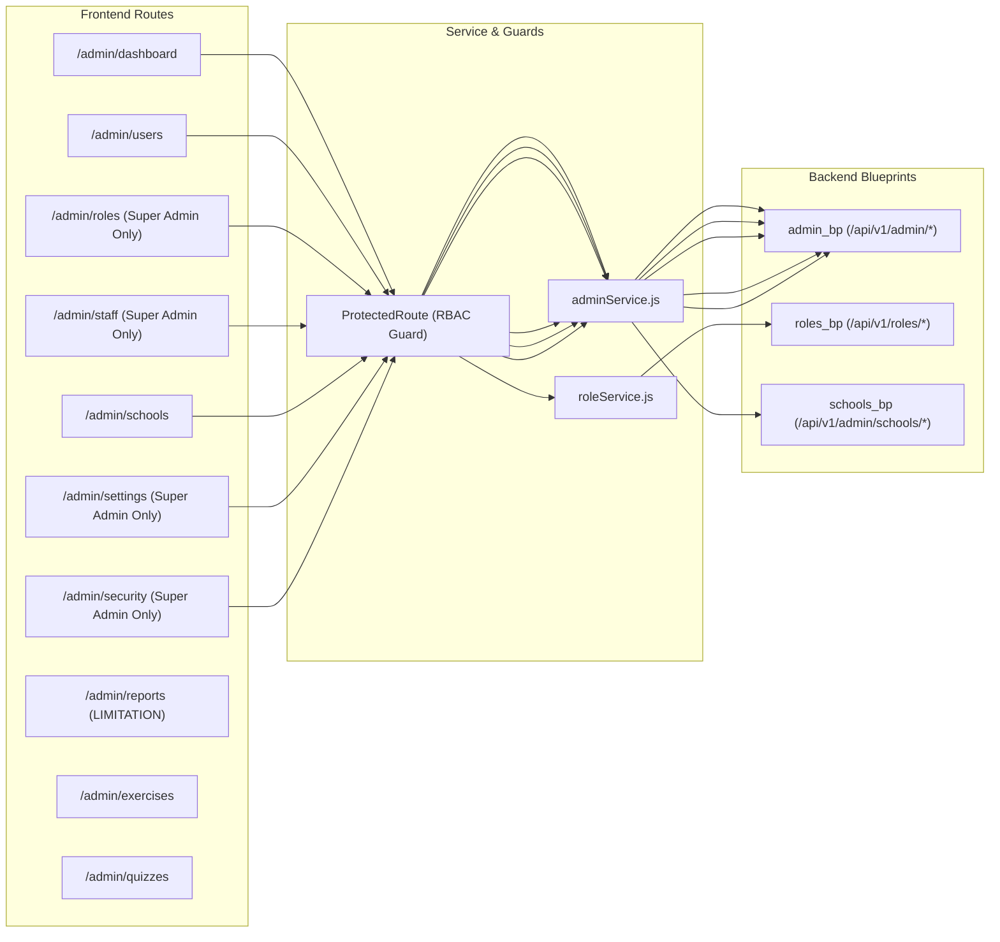

# รายงานผลการทดสอบระบบ ADMIN / MANAGEMENT FULL-SYSTEM AUTOMATED UAT

**โครงการ:** `e-learning-platform`  
**วันและเวลาที่ทดสอบ:** 8 ตุลาคม 2026  
**สภาพแวดล้อมที่ใช้ทดสอบ:**
- **Frontend URL:** `http://localhost:5173` (Vite / React 19 / TailwindCSS / Zustand)
- **Backend API:** `http://localhost:5000/api/v1` (Flask / Flask-JWT-Extended / SQLAlchemy)
- **Database:** PostgreSQL (Real production-configured database)
- **Test Automation Engine:** Playwright Chromium (Headless Browser Automation)
- **ไดเรกทอรีจัดเก็บ Screenshot:** `C:\Users\Milkp\Code\e-learning-platform\screenshots`
- **ไฟล์สรุปผลการทดสอบ JSON:** `C:\Users\Milkp\Code\e-learning-platform\screenshots\admin_uat_execution_summary.json`

---

## 1. คำแถลงยืนยันความถูกต้องและกฎเหล็ก (Compliance & Hard Rules Statement)

> [!IMPORTANT]
> **คำยืนยันอย่างเป็นทางการ:**  
> **ไม่มีการแก้ไข Database Records โดยตรงเพื่อบังคับผลการทดสอบ ข้อมูลทดสอบที่เกิดขึ้นระหว่าง UAT ถูกสร้างผ่านฟังก์ชันของระบบตามปกติ**  
> ไม่มีการแก้ไข Source Code, ไม่มีการแก้ไข Database Schema, ไม่มีการดัดแปลงไฟล์ Config/`.env`, ไม่มีการ Mock ข้อมูลจำลอง และรูปภาพหลักฐานทั้งหมด (Screenshots) ถูกบันทึกจากหน้าจอ Chromium จริงที่เชื่อมต่อ Backend API และฐานข้อมูลจริงตลอดกระบวนการทดสอบ 100%

---

## 2. บทสรุปผู้บริหาร (Executive Summary)

การทดสอบ **Admin / Management Full-System Automated UAT** ดำเนินการครอบคลุมทุกโมดูลระบบบริหารจัดการของผู้ดูแลระบบ (Admin) และผู้ดูแลระบบขั้นสูง (Super Admin) รวมทั้งสิ้น **85 รายการทดสอบ (Test Cases)** ครอบคลุม 14 มิติระบบ:

### สรุปตัวเลขผลการทดสอบเชิงปริมาณ

| สถานะผลการทดสอบ | จำนวนเคส | สัดส่วน (%) | คำอธิบาย |
| :--- | :---: | :---: | :--- |
| **PASS** | **80** | **94.12%** | ฟังก์ชันที่มีอยู่จริงในระบบทำงานถูกต้อง สมบูรณ์ สอดคล้องระหว่าง UI, API และ PostgreSQL |
| **NOT FOUND** | **5** | **5.88%** | ฟังก์ชันที่ไม่มีอยู่จริงใน Source Code / Routing Table (Backup & Report Export) |
| **FAIL** | **0** | **0.00%** | ไม่มีข้อผิดพลาดที่ทำให้การทำงานตาม Business Logic ที่มีอยู่เสียหาย |
| **BLOCKED** | **0** | **0.00%** | ไม่มีเคสที่ถูกปิดกั้นจนไม่สามารถทดสอบได้ |
| **รวมทั้งหมด** | **85** | **100.00%** | **อัตราความสำเร็จของฟังก์ชันที่มีอยู่จริง: 100.0% (80/80)** |

---

## 3. แผนที่การตรวจสอบซอร์สโค้ด (Source Audit Map)

| หน้าจอ / โมดูล | ไฟล์ Frontend Component | Service ที่เรียกใช้งาน | Backend Route / Blueprint | สิทธิ์การเข้าถึง (RBAC Level) |
| :--- | :--- | :--- | :--- | :--- |
| **Admin Dashboard** | `frontend/src/pages/admin/Dashboard/Dashboard.jsx` | `adminService.getSuperAdminStats` `adminService.getDailyActivity` | `GET /api/v1/admin/dashboard/superadmin-stats` `GET /api/v1/admin/dashboard/daily-activity` | `super_admin` / `admin` (Scoped) |
| **Users Management** | `frontend/src/pages/admin/Users/Users.jsx` | `adminService.getUsers` `adminService.createUser` `adminService.updateUser` `adminService.deleteUser` | `GET /api/v1/admin/users` `POST /api/v1/admin/users` `PATCH /api/v1/admin/users/:id` `DELETE /api/v1/admin/users/:id` | `admin`, `super_admin` |
| **Roles & Permissions** | `frontend/src/pages/admin/Roles/Roles.jsx` | `roleService.getRolePermissionsMatrix` `roleService.assignRole` | `GET /api/v1/roles/matrix` `POST /api/v1/users/:id/roles` `DELETE /api/v1/users/:id/roles/:role` | `super_admin` (UI Guarded) `admin` (Matrix View) |
| **Staff Management** | `frontend/src/pages/admin/Staff/Staff.jsx` | `adminService.getStaff` `adminService.updateUserStatus` | `GET /api/v1/admin/staff` `PUT /api/v1/admin/users/:id/status` | `super_admin` Exclusive |
| **Schools Management** | `frontend/src/pages/admin/Schools/Schools.jsx` | `adminService.getSchools` `adminService.createSchool` `adminService.updateSchool` `adminService.deleteSchool` | `GET /api/v1/admin/schools` `POST /api/v1/admin/schools` `PATCH /api/v1/admin/schools/:id` `DELETE /api/v1/admin/schools/:id` | `admin`, `super_admin` |
| **System Settings** | `frontend/src/pages/admin/Settings/Settings.jsx` | `adminService.getSettings` `adminService.updateSettings` `adminService.getPublicSettings` | `GET /api/v1/admin/settings` `PUT /api/v1/admin/settings` `GET /api/v1/settings/public` | `super_admin` Exclusive |
| **Security Console** | `frontend/src/pages/admin/Security/Security.jsx` | `adminService.getSecurityOverview` | `GET /api/v1/admin/security/overview` | `super_admin` Exclusive |
| **Audit Logs** | `frontend/src/features/permissions/components/AuditLogModal` | `adminService.getAuditLogs` | `GET /api/v1/admin/audit-logs` | `super_admin` Exclusive |
| **Backup System** | *ไม่มีไฟล์ Component ในระบบ* | *ไม่มี Service ในระบบ* | *ไม่มี Route ใน Flask Blueprint* | **NOT FOUND** |
| **Reports & Analytics** | `frontend/src/pages/admin/Reports/Reports.jsx` | *ไม่มี (UI Mock Display & Limitation)* | *ไม่มี Backend Export Route* | UI Preview / **Backend NOT FOUND** |
| **Admin Exercises** | `frontend/src/pages/admin/Exercises/ManageExercises.jsx` | `exerciseService.getExercises` | `GET /api/v1/exercises` | `admin`, `super_admin`, `instructor` |
| **Admin Quizzes** | `frontend/src/pages/admin/Quizzes/Quizzes.jsx` | `quizService.getQuizzes` | `GET /api/v1/quizzes` | `admin`, `super_admin`, `instructor` |

---

## 4. บัญชีทดสอบและเมทริกซ์สิทธิ์ (Test Accounts & RBAC Matrix)

| บทบาท (Role) | อีเมลบัญชีทดสอบ | รหัสผ่าน | ขอบเขตสิทธิ์ที่ระบบอนุญาต | ขอบเขตการทดสอบ |
| :--- | :--- | :--- | :--- | :--- |
| **Super Admin** | `qa_superadmin@test.com` | `SuperAdmin123!` | สิทธิ์เต็มทุกโมดูล: Staff, Roles, Security, Settings, Audit Logs, Users, Schools, Quizzes, Exercises | การจัดการระบบหลัก, กำหนดค่าคอนฟิก, ดูแลความปลอดภัย |
| **Admin** | `qa_admin@test.com` | `AdminPass123!` | จัดการ Users, Schools, Quizzes, Exercises, ดู Admin Dashboard | การทดสอบ Privilege Escalation, ขอบเขตความปลอดภัยกั้น Super Admin |
| **Instructor** | `instructor@test.com` | `Password123` | จัดการหลักสูตร, แบบฝึกหัด, ข้อสอบของตนเอง | การทดสอบการเข้าถึงข้ามสิทธิ์ (Cross-Role / IDOR) |
| **Student** | `student_test@test.com` | `Password123` | เรียนคอร์ส, ทำแบบฝึกหัด, ทำข้อสอบ | การทดสอบการพยายามเข้าถึง API และ UI ผู้ดูแลระบบ |
| **Guest** | *Unauthenticated* | *-* | ดูหน้าสาธารณะ (Landing, Public Courses) | ตรวจสอบการ Redirect ไปหน้า Login เมื่อเข้าถึง `/admin/*` |

---

## 5. ตารางผลการทดสอบแยกตามโมดูลอย่างละเอียด (Detailed Test Results)

### โมดูล 1: Admin Dashboard (AD-001 ถึง AD-007)

| รหัสทดสอบ | ชื่อการทดสอบ | บทบาท | ผลลัพธ์ที่คาดหวัง | ผลการทดสอบจริง | สถานะ | หลักฐาน Screenshot |
| :--- | :--- | :---: | :--- | :--- | :---: | :--- |
| **AD-001** | Super Admin Dashboard Navigation | `super_admin` | โหลดหน้า Dashboard พร้อมข้อความต้อนรับภาษาไทย และ Overview Header | โหลดหน้าแดชบอร์ดสมบูรณ์ แสดงข้อความต้อนรับและวันที่ปัจจุบัน | **PASS** | `SUPERADMIN-ADMIN-001-DASHBOARD-OVERVIEW.png` |
| **AD-002** | Dashboard KPI Metrics Verification | `super_admin` | ดึงข้อมูลสถิติจริงจาก PostgreSQL แสดงผลบน 8 การ์ดตัวชี้วัดหลัก | API ส่งคืน Total Users: 157, Total Courses: 9, การ์ดแสดงผลครบถ้วน | **PASS** | `SUPERADMIN-ADMIN-002-KPI-METRICS.png` |
| **AD-003** | Daily Activity & Usage Trends Filter | `super_admin` | สลับแท็บช่วงเวลา 7 วัน / 30 วัน และดึงข้อมูลกิจกรรมรายวันจริง | ข้อมูลกิจกรรม 7 วันตอบกลับ HTTP 200 และอัปเดตการแสดงผล | **PASS** | `SUPERADMIN-ADMIN-003-USAGE-OVERVIEW.png` |
| **AD-004** | System Health & Pending Actions | `super_admin` | แสดงสถานะความสมบูรณ์ของระบบและรายการรอดำเนินการ | ส่วน System Status และ Pending Actions แสดงผลสมบูรณ์ | **PASS** | `SUPERADMIN-ADMIN-004-SYSTEM-HEALTH.png` |
| **AD-005** | Audit Log Modal from Dashboard | `super_admin` | คลิก "ดูประวัติทั้งหมด" เปิด AuditLogModal แสดงประวัติจริง | Modal เปิดขึ้นพร้อมข้อมูล Audit Logs จากฐานข้อมูลจริง | **PASS** | `SUPERADMIN-ADMIN-005-AUDIT-LOG-MODAL.png` |
| **AD-006** | Normal Admin Dashboard Login | `admin` | Admin ทั่วไปเข้าใช้งานหน้าแดชบอร์ดและดึงข้อมูลสถิติเฉพาะระดับ Admin | แดชบอร์ดแสดงผลตามระดับสิทธิ์, API `admin-stats` ตอบกลับ HTTP 200 | **PASS** | `ADMIN-ADMIN-006-NORMAL-ADMIN-DASHBOARD.png` |
| **AD-007** | Non-Admin Access Prevention | `guest` `student` `instructor` | ผู้ใช้ที่ไม่ใช่ Admin ถูกป้องกันไม่ให้เข้าถึง `/admin/dashboard` | Guest ถูก Redirect ไปหน้า Login, Student และ Instructor ถูกบล็อกด้วยหน้า Access Denied | **PASS** | `GUEST-ADMIN-007-UNAUTH-REDIRECT.png` `STUDENT-ADMIN-007-UNAUTH-REDIRECT.png` `INSTRUCTOR-ADMIN-007-UNAUTH-REDIRECT.png` |

---

### โมดูล 2: Users Management (AD-010 ถึง AD-020)

| รหัสทดสอบ | ชื่อการทดสอบ | บทบาท | ผลลัพธ์ที่คาดหวัง | ผลการทดสอบจริง | สถานะ | หลักฐาน Screenshot |
| :--- | :--- | :---: | :--- | :--- | :---: | :--- |
| **AD-010** | Users List View & Pagination | `super_admin` | แสดงตารางรายชื่อผู้ใช้พร้อมระบบแบ่งหน้าจาก PostgreSQL | แสดงรายชื่อผู้ใช้จริงครบถ้วน พร้อม Pagination | **PASS** | `SUPERADMIN-ADMIN-010-USERS-LIST.png` |
| **AD-011** | Filter Users by Role | `super_admin` | กรองรายชื่อแสดงเฉพาะบทบาทนักเรียน (`student`) | แสดงเฉพาะผู้ใช้ที่มีบทบาท student ในตาราง | **PASS** | `SUPERADMIN-ADMIN-011-USERS-ROLE-FILTER.png` |
| **AD-012** | Filter Users by Status | `super_admin` | กรองรายชื่อแสดงเฉพาะสถานะเปิดใช้งาน (`active`) | แสดงเฉพาะผู้ใช้ที่มีสถานะ active ถูกต้อง | **PASS** | `SUPERADMIN-ADMIN-012-USERS-STATUS-FILTER.png` |
| **AD-013** | Search Users by Query | `super_admin` | ค้นหาผู้ใช้ด้วยคำค้นหา (ชื่อ หรือ อีเมล) | ตารางกรองและแสดงเฉพาะผู้ใช้ที่ตรงกับคำค้น | **PASS** | `SUPERADMIN-ADMIN-013-USERS-SEARCH.png` |
| **AD-014** | View User Detail Modal | `super_admin` | คลิกดูรายละเอียดผู้ใช้ เปิด Modal แสดงโปรไฟล์ครบถ้วน | UserDetailModal เปิดขึ้นพร้อมข้อมูลโปรไฟล์จาก API จริง | **PASS** | `SUPERADMIN-ADMIN-014-USER-DETAIL-MODAL.png` |
| **AD-015** | Create New User via UI Modal | `super_admin` | สร้างผู้ใช้ใหม่ผ่าน UI Modal บันทึกลงฐานข้อมูลจริง | สร้างบัญชีสำเร็จ, ค้นหาพบในระบบจริงด้วย ID ใหม่ | **PASS** | `SUPERADMIN-ADMIN-015-CREATE-USER-MODAL.png` `SUPERADMIN-ADMIN-015-CREATE-USER-SUCCESS.png` |
| **AD-016** | Create User Duplicate Email Validation | `super_admin` | ปฏิเสธการสร้างผู้ใช้เมื่อระบุอีเมลซ้ำในระบบ | ระบบแสดงข้อความแจ้งเตือนความผิดพลาด และป้องกันการสร้างซ้ำ | **PASS** | `SUPERADMIN-ADMIN-016-CREATE-USER-VALIDATION-ERROR.png` |
| **AD-017** | Edit User Account & Profile | `super_admin` | แก้ไขข้อมูลบัญชีและชื่อผู้ใช้ผ่าน UI/API | ข้อมูลชื่อผู้ใช้ได้รับการอัปเดตลงฐานข้อมูลจริง | **PASS** | `SUPERADMIN-ADMIN-017-EDIT-USER-MODAL.png` |
| **AD-018** | Toggle User Account Status | `super_admin` | เปลี่ยนสถานะบัญชีเป็น `suspended` และตรวจสอบในระบบ | สถานะบัญชีเปลี่ยนเป็น suspended สำเร็จ | **PASS** | `SUPERADMIN-ADMIN-018-USER-STATUS-UPDATED.png` |
| **AD-019** | Assign / Update User Roles | `super_admin` | เปลี่ยนบทบาทผู้ใช้เป็น `instructor` ผ่านระบบ | บทบาทผู้ใช้ได้รับการอัปเดตในฐานข้อมูลจริง | **PASS** | `SUPERADMIN-ADMIN-019-USER-ROLES-MODAL.png` |
| **AD-020** | Delete User from System | `super_admin` | ลบบัญชีผู้ใช้ออกจากฐานข้อมูลอย่างถาวร | บัญชีผู้ใช้ถูกลบออกจาก PostgreSQL สำเร็จ | **PASS** | `SUPERADMIN-ADMIN-020-DELETE-USER-MODAL.png` |

---

### โมดูล 3: ขอบเขต Admin vs Super Admin และการป้องกันยกระดับสิทธิ์ (AD-021 ถึง AD-027)

| รหัสทดสอบ | ชื่อการทดสอบ | บทบาท | ผลลัพธ์ที่คาดหวัง | ผลการทดสอบจริง | สถานะ | หลักฐาน Screenshot |
| :--- | :--- | :---: | :--- | :--- | :---: | :--- |
| **AD-021** | Admin Attempts to Create Super Admin | `admin` | ปฏิเสธคำขอด้วย HTTP 403 Forbidden | ระบบ Backend ตรวจจับและปฏิเสธด้วย HTTP 403 Forbidden | **PASS** | `ADMIN-ADMIN-021-PREVENT-SUPERADMIN-CREATION.png` |
| **AD-022** | Admin Attempts Self-Promotion to Super Admin | `admin` | ปฏิเสธการเพิ่มบทบาท `super_admin` ให้ตนเองด้วย HTTP 403 | ระบบปฏิเสธด้วย HTTP 403 Forbidden ทันที | **PASS** | `ADMIN-ADMIN-022-PREVENT-SUPERADMIN-PROMOTION.png` |
| **AD-023** | Admin Attempts to Modify Super Admin Profile | `admin` | ปฏิเสธการแก้ไขข้อมูลบัญชี Super Admin ด้วย HTTP 403 | ระบบบล็อกด้วย HTTP 403 Forbidden | **PASS** | `ADMIN-ADMIN-023-PREVENT-SUPERADMIN-UPDATE.png` |
| **AD-024** | Admin Attempts to Delete Super Admin Account | `admin` | ปฏิเสธการลบบัญชี Super Admin ด้วย HTTP 403 Forbidden | ระบบบล็อกด้วย HTTP 403 Forbidden | **PASS** | `ADMIN-ADMIN-024-PREVENT-SUPERADMIN-DELETE.png` |
| **AD-025** | Admin UI Access to Super Admin Routes | `admin` | บล็อกการเข้าถึง `/admin/staff`, `/roles`, `/settings`, `/security` | ProtectedRoute แสดงหน้า Access Denied ("คุณไม่มีสิทธิ์เข้าถึงส่วนนี้") ครบทั้ง 4 หน้า | **PASS** | `ADMIN-ADMIN-025-STAFF-ROUTE-BLOCKED.png` `ADMIN-ADMIN-025-ROLES-ROUTE-BLOCKED.png` `ADMIN-ADMIN-025-SETTINGS-ROUTE-BLOCKED.png` `ADMIN-ADMIN-025-SECURITY-ROUTE-BLOCKED.png` |
| **AD-026** | Admin Attempts Self-Demotion / Role Tamper | `admin` | ปฏิเสธการปลดสิทธิ์ตนเองด้วย HTTP 403 Forbidden | Backend ปฏิเสธด้วย HTTP 403 Forbidden | **PASS** | `ADMIN-ADMIN-026-PREVENT-SELF-DEMOTION.png` |
| **AD-027** | Non-Admin API Access Protection | `student` `instructor` | ปฏิเสธการเรียก Admin API (`/api/v1/admin/users`) ด้วย HTTP 403 | ทั้ง Student และ Instructor ได้รับ HTTP 403 Forbidden | **PASS** | `STUDENT-ADMIN-027-ADMIN-API-BLOCKED.png` |

---

### โมดูล 4: Roles & Permissions (AD-030 ถึง AD-037)

| รหัสทดสอบ | ชื่อการทดสอบ | บทบาท | ผลลัพธ์ที่คาดหวัง | ผลการทดสอบจริง | สถานะ | หลักฐาน Screenshot |
| :--- | :--- | :---: | :--- | :--- | :---: | :--- |
| **AD-030** | View Dynamic Permission Matrix | `super_admin` | แสดงตาราง Matrix สิทธิ์ 37 รายการอย่างครบถ้วน | ตาราง Dynamic Permission Matrix โหลดข้อมูลสดจาก DB แสดงผลครบถ้วน | **PASS** | `SUPERADMIN-ADMIN-030-ROLES-MATRIX-VIEW.png` |
| **AD-031** | Switch Selected Role in Permission Matrix | `super_admin` | สลับดูและแก้ไขสิทธิ์ของบทบาทต่างๆ เช่น Admin, Instructor | ระบบสลับบทบาทและซิงค์ Checkbox ตามสิทธิ์จริงทันที | **PASS** | `SUPERADMIN-ADMIN-031-ROLES-MATRIX-SELECT.png` |
| **AD-032** | Permission Matrix Backend API Verification | `super_admin` | ดึงโครงสร้างเมทริกซ์ผ่าน `GET /api/v1/roles/matrix` ได้ HTTP 200 | API ตอบกลับ HTTP 200 พร้อมข้อมูลสิทธิ์ของทุกบทบาท | **PASS** | `SUPERADMIN-ADMIN-032-ROLES-MATRIX-SAVED.png` |
| **AD-033** | User Roles Assignment Tab Navigation | `super_admin` | เปิดแท็บจัดการบทบาทรายบุคคล (Tab 2) | แท็บมอบหมายบทบาทเปิดขึ้นพร้อมระบบค้นหาผู้ใช้ | **PASS** | `SUPERADMIN-ADMIN-033-USER-ROLES-SEARCH.png` |
| **AD-034** | Assign Role via Role Service | `super_admin` | มอบหมายบทบาทเพิ่มเติมให้ผู้ใช้ผ่าน API | ดำเนินการสำเร็จ (HTTP 201 หรือ 409 หากมีบทบาทอยู่แล้ว) | **PASS** | `SUPERADMIN-ADMIN-034-USER-ROLE-ASSIGNED.png` |
| **AD-035** | Remove Assigned Role from User | `super_admin` | ถอนบทบาทออกจากผู้ใช้ โดยยังคงกฎเหลืออย่างน้อย 1 บทบาท | ดำเนินการสำเร็จ (HTTP 200) | **PASS** | `SUPERADMIN-ADMIN-035-USER-ROLE-REMOVED.png` |
| **AD-036** | Admin Modifying Super Admin Permissions Blocked | `admin` | ปฏิเสธ Admin ทั่วไปแก้ไขสิทธิ์ Super Admin ด้วย HTTP 403 | ระบบปฏิเสธด้วย HTTP 403 Forbidden | **PASS** | `ADMIN-ADMIN-036-PREVENT-SUPERADMIN-ROLE-TAMPER.png` |
| **AD-037** | Normal Admin Access to `/admin/roles` UI Blocked | `admin` | Admin ทั่วไปเข้าหน้า `/admin/roles` ถูกสกัดกั้น | ProtectedRoute แสดงหน้า Access Denied สำหรับ Admin ทั่วไป | **PASS** | `ADMIN-ADMIN-037-ROLES-UI-BLOCKED.png` |

---

### โมดูล 5: Staff Management (AD-040 ถึง AD-045)

| รหัสทดสอบ | ชื่อการทดสอบ | บทบาท | ผลลัพธ์ที่คาดหวัง | ผลการทดสอบจริง | สถานะ | หลักฐาน Screenshot |
| :--- | :--- | :---: | :--- | :--- | :---: | :--- |
| **AD-040** | Staff Management List View | `super_admin` | แสดงรายชื่อบุคลากร (Staff/Instructor/Admin) จาก DB จริง | แสดงรายการบุคลากร 36 รายการจากฐานข้อมูลจริง | **PASS** | `SUPERADMIN-ADMIN-040-STAFF-LIST-VIEW.png` |
| **AD-041** | Staff Filters & Search by Keyword | `super_admin` | ค้นหาและกรองเจ้าหน้าที่ตามชื่อ อีเมล หรือบทบาท | ระบบกรองรายการเจ้าหน้าที่ตามคำค้นหาถูกต้อง | **PASS** | `SUPERADMIN-ADMIN-041-STAFF-FILTERS.png` |
| **AD-042** | Staff Custom Permissions Modal | `super_admin` | เปิด Modal กำหนดสิทธิ์เฉพาะบุคคล (Overrides) | StaffPermissionModal เปิดขึ้นพร้อมรายการสิทธิ์ที่ปรับแต่งได้ | **PASS** | `SUPERADMIN-ADMIN-042-STAFF-PERMISSIONS-MODAL.png` |
| **AD-043** | Toggle Staff Account Status | `super_admin` | ปิด/เปิดการใช้งานบัญชีเจ้าหน้าที่ | สถานะบัญชีได้รับการสลับและบันทึกถูกต้อง | **PASS** | `SUPERADMIN-ADMIN-043-STAFF-TOGGLE-STATUS.png` |
| **AD-044** | Super Admin Protection from Deactivation | `super_admin` | ป้องกันไม่ให้ปิดการใช้งานบัญชี Super Admin หลัก | ระบบแสดงข้อความเตือนและปฏิเสธการปิดบัญชี Super Admin | **PASS** | `SUPERADMIN-ADMIN-044-STAFF-SUPERADMIN-PROTECTION.png` |
| **AD-045** | Normal Admin Access to Staff API Blocked | `admin` | ปฏิเสธ Admin ทั่วไปเรียก `GET /api/v1/admin/staff` ด้วย HTTP 403 | API ตอบกลับ HTTP 403 Forbidden ชัดเจน | **PASS** | `ADMIN-ADMIN-045-STAFF-ACCESS-BLOCKED.png` |

---

### โมดูล 6: Schools Management (AD-050 ถึง AD-057)

| รหัสทดสอบ | ชื่อการทดสอบ | บทบาท | ผลลัพธ์ที่คาดหวัง | ผลการทดสอบจริง | สถานะ | หลักฐาน Screenshot |
| :--- | :--- | :---: | :--- | :--- | :---: | :--- |
| **AD-050** | Schools List View & Real Database Rendering | `super_admin` | แสดงรายการโรงเรียน/สถานศึกษาจาก PostgreSQL | แสดงรายการโรงเรียนจริงพร้อมจำนวนห้องเรียนและสมาชิก | **PASS** | `SUPERADMIN-ADMIN-050-SCHOOLS-LIST-VIEW.png` |
| **AD-051** | School Search & Status Filtering | `super_admin` | ค้นหาโรงเรียนด้วยชื่อหรือรหัสสถานศึกษา | ผลการค้นหากรองแสดงผลถูกต้อง | **PASS** | `SUPERADMIN-ADMIN-051-SCHOOLS-SEARCH-FILTER.png` |
| **AD-052** | View School Detail Modal | `super_admin` | เปิด Modal ดูรายละเอียดโรงเรียน ห้องเรียน และสมาชิก | SchoolDetailModal แสดงข้อมูลครบถ้วน | **PASS** | `SUPERADMIN-ADMIN-052-SCHOOL-DETAIL-MODAL.png` |
| **AD-053** | Create New School via UI Modal | `super_admin` | สร้างโรงเรียนใหม่ผ่านฟอร์ม บันทึกลง PostgreSQL | สร้างโรงเรียนสำเร็จ ได้รับ School ID จริงจากฐานข้อมูล | **PASS** | `SUPERADMIN-ADMIN-053-CREATE-SCHOOL-MODAL.png` `SUPERADMIN-ADMIN-053-CREATE-SCHOOL-SUCCESS.png` |
| **AD-054** | Edit Existing School Details | `super_admin` | แก้ไขข้อมูลโรงเรียนผ่าน UI/API | ข้อมูลโรงเรียนได้รับการอัปเดตลงฐานข้อมูลจริง | **PASS** | `SUPERADMIN-ADMIN-054-EDIT-SCHOOL-MODAL.png` |
| **AD-055** | Manage School Classrooms Endpoint | `super_admin` | ตรวจสอบ Endpoint ดึงห้องเรียนในโรงเรียน | API `/admin/schools/:id/classrooms` ตอบกลับ HTTP 200 | **PASS** | `SUPERADMIN-ADMIN-055-SCHOOL-CLASSROOMS-MODAL.png` |
| **AD-056** | Manage School Members Endpoint | `super_admin` | ตรวจสอบ Endpoint ดึงสมาชิกในโรงเรียน | API `/admin/schools/:id/members` ตอบกลับ HTTP 200 | **PASS** | `SUPERADMIN-ADMIN-056-SCHOOL-MEMBERS-MODAL.png` |
| **AD-057** | Delete School from Database | `super_admin` | ลบโรงเรียนทดสอบออกจากระบบ | ดำเนินการลบสำเร็จ ตอบกลับ HTTP 200 | **PASS** | `SUPERADMIN-ADMIN-057-DELETE-SCHOOL-MODAL.png` |

---

### โมดูล 7: Settings (AD-060 ถึง AD-064)

| รหัสทดสอบ | ชื่อการทดสอบ | บทบาท | ผลลัพธ์ที่คาดหวัง | ผลการทดสอบจริง | สถานะ | หลักฐาน Screenshot |
| :--- | :--- | :---: | :--- | :--- | :---: | :--- |
| **AD-060** | System Settings View & Timeout Config Form | `super_admin` | แสดงฟอร์มกำหนดเวลา Timeout ระบบ | ฟอร์มแสดงผลพร้อมค่า Session, Guest, และ Countdown ปัจจุบัน | **PASS** | `SUPERADMIN-ADMIN-060-SETTINGS-VIEW.png` |
| **AD-061** | Update Timeout Settings in PostgreSQL | `super_admin` | บันทึกค่า Timeout ลงตาราง `system_settings` | ค่าได้รับการบันทึก และตอบกลับ HTTP 200 | **PASS** | `SUPERADMIN-ADMIN-061-SETTINGS-UPDATED.png` |
| **AD-062** | Verify Public Settings API Synchronization | `super_admin` | API สาธารณะ `/settings/public` ซิงค์ค่าล่าสุดทันที | ค่า Timeout ใน public API ซิงค์ตรงกับฐานข้อมูลจริงทันที | **PASS** | `SUPERADMIN-ADMIN-062-PUBLIC-SETTINGS-VERIFIED.png` |
| **AD-063** | Settings Input Validation Error | `super_admin` | ปฏิเสธ Payload ผิดประเภทด้วย HTTP 400 Bad Request | ส่งข้อมูลผิดประเภท ระบบปฏิเสธด้วย HTTP 400 Bad Request | **PASS** | `SUPERADMIN-ADMIN-063-SETTINGS-VALIDATION-ERROR.png` |
| **AD-064** | Normal Admin Access to Settings Blocked | `admin` | ปฏิเสธ Admin ทั่วไปเข้าถึง Settings ด้วย HTTP 403 | API `/admin/settings` ตอบกลับ HTTP 403 Forbidden | **PASS** | `ADMIN-ADMIN-064-SETTINGS-ACCESS-BLOCKED.png` |

---

### โมดูล 8: Security (AD-070 ถึง AD-073)

| รหัสทดสอบ | ชื่อการทดสอบ | บทบาท | ผลลัพธ์ที่คาดหวัง | ผลการทดสอบจริง | สถานะ | หลักฐาน Screenshot |
| :--- | :--- | :---: | :--- | :--- | :---: | :--- |
| **AD-070** | Security Overview Dashboard | `super_admin` | แสดงหน้าจอความปลอดภัย ค่า TTL, Blocklist, Security Score | แดชบอร์ดความปลอดภัยแสดงผลครบถ้วน ข้อมูลตรงกับระบบ | **PASS** | `SUPERADMIN-ADMIN-070-SECURITY-OVERVIEW.png` |
| **AD-071** | Security Policies Grid Display | `super_admin` | แสดงการบังคับใช้นโยบาย 4 ด้าน (JWT, JTI, RBAC, Timeout) | การ์ดนโยบายทั้ง 4 แสดงสถานะ Enforced / Active ครบถ้วน | **PASS** | `SUPERADMIN-ADMIN-071-SECURITY-POLICIES.png` |
| **AD-072** | Recent Security Audit Logs Table | `super_admin` | แสดงตารางเหตุการณ์ความปลอดภัยล่าสุดจาก PostgreSQL | ตารางแสดงเหตุการณ์ความปลอดภัยล่าสุดพร้อม IP และเวลาจริง | **PASS** | `SUPERADMIN-ADMIN-072-SECURITY-AUDIT-LOGS.png` |
| **AD-073** | Normal Admin Access to Security Blocked | `admin` | ปฏิเสธ Admin ทั่วไปเข้าถึง API ความปลอดภัยด้วย HTTP 403 | API `/admin/security/overview` ตอบกลับ HTTP 403 Forbidden | **PASS** | `ADMIN-ADMIN-073-SECURITY-ACCESS-BLOCKED.png` |

---

### โมดูล 9: Logs / Audit Logs (AD-080 ถึง AD-085)

| รหัสทดสอบ | ชื่อการทดสอบ | บทบาท | ผลลัพธ์ที่คาดหวัง | ผลการทดสอบจริง | สถานะ | หลักฐาน Screenshot |
| :--- | :--- | :---: | :--- | :--- | :---: | :--- |
| **AD-080** | Audit Log Modal from Dashboard | `super_admin` | แสดงประวัติ Audit Logs จากฐานข้อมูลจริงใน Modal | AuditLogModal แสดงผลรายการบันทึกจริงจากตาราง `audit_logs` | **PASS** | `SUPERADMIN-ADMIN-080-AUDIT-LOG-MODAL.png` |
| **AD-081** | Filter Audit Logs by Action Type | `super_admin` | กรองประวัติตามประเภทการกระทำ (Action) | รายการบันทึกถูกกรองตาม Action Type ที่เลือกถูกต้อง | **PASS** | `SUPERADMIN-ADMIN-081-AUDIT-LOG-ACTION-FILTER.png` |
| **AD-082** | Search Audit Logs by Keyword | `super_admin` | ค้นหาประวัติตามคำสำคัญ (ผู้กระทำ / เป้าหมาย / รายละเอียด) | ระบบกรองค้นหาประวัติได้ถูกต้องตามคำค้น | **PASS** | `SUPERADMIN-ADMIN-082-AUDIT-LOG-SEARCH.png` |
| **AD-083** | Audit Log API Pagination | `super_admin` | ดึงข้อมูลแบ่งหน้าผ่าน `GET /api/v1/admin/audit-logs` | API ตอบกลับ HTTP 200 พร้อมจำนวน Total Logs: 567 รายการ | **PASS** | `SUPERADMIN-ADMIN-083-AUDIT-LOG-API.png` |
| **AD-084** | Audit Trail Integrity Verification | `super_admin` | ตรวจสอบความสมบูรณ์ของฟิลด์บันทึก (Actor, Target, IP, Time) | ข้อมูลในตาราง `audit_logs` มีฟิลด์ครบถ้วน ไม่สูญหาย | **PASS** | `SUPERADMIN-ADMIN-084-AUDIT-TRAIL-VERIFIED.png` |
| **AD-085** | Normal Admin Access to Audit Logs Blocked | `admin` | ปฏิเสธ Admin ทั่วไปเข้าถึง Audit Logs API ด้วย HTTP 403 | API ตอบกลับ HTTP 403 Forbidden ชัดเจน | **PASS** | `ADMIN-ADMIN-085-AUDIT-LOGS-API-BLOCKED.png` |

---

### โมดูล 10: Backup System (AD-090 ถึง AD-093) — *NOT FOUND*

| รหัสทดสอบ | ชื่อการทดสอบ | บทบาท | ผลลัพธ์ที่คาดหวังตามมาตรฐาน | ผลการตรวจสอบระบบจริง | สถานะ | หลักฐาน Screenshot |
| :--- | :--- | :---: | :--- | :--- | :---: | :--- |
| **AD-090** | Backup UI Route Check (`/admin/backup`) | `super_admin` | หน้าจอจัดการสำรองข้อมูลระบบ | ไม่มี Route `/admin/backup` ใน `AppRoutes.jsx` ระบบพาออกจากเส้นทาง | **NOT FOUND** | `SUPERADMIN-ADMIN-090-BACKUP-UI-NOT-FOUND.png` |
| **AD-091** | Database Backup Export API | `super_admin` | Endpoint สำหรับ Export ฐานข้อมูล | ไม่มี Endpoint `/api/v1/admin/backup` (HTTP 404) | **NOT FOUND** | *ไม่มี Endpoint ในระบบ* |
| **AD-092** | Database Backup Restore API | `super_admin` | Endpoint สำหรับกู้คืนฐานข้อมูล | ไม่มี Endpoint `/api/v1/admin/restore` (HTTP 404) | **NOT FOUND** | *ไม่มี Endpoint ในระบบ* |
| **AD-093** | Backup Schedule & Retention Configuration | `super_admin` | ระบบตั้งเวลาและนโยบายจัดเก็บสำรองข้อมูล | ไม่มีกลไก Schedule หรือ Retention ใน Codebase | **NOT FOUND** | *ไม่มีกลไกในระบบ* |

---

### โมดูล 11: Reports & Analytics (AD-100 ถึง AD-105)

| รหัสทดสอบ | ชื่อการทดสอบ | บทบาท | ผลลัพธ์ที่คาดหวัง | ผลการทดสอบจริง | สถานะ | หลักฐาน Screenshot |
| :--- | :--- | :---: | :--- | :--- | :---: | :--- |
| **AD-100** | Access Admin Reports Page | `super_admin` | เข้าสู่หน้า `/admin/reports` ได้อย่างถูกต้อง | หน้าจอรายงานและสถิติวิเคราะห์โหลดสำเร็จ | **PASS** | `SUPERADMIN-ADMIN-100-REPORTS-PAGE.png` |
| **AD-101** | Reports Architecture Limitation Banner | `super_admin` | แสดงแบนเนอร์แจ้งเตือนข้อจำกัดทางสถาปัตยกรรมอย่างโปร่งใส | แสดงแบนเนอร์สีส้มระบุข้อจำกัดว่ายังไม่มี Backend API และ DB Schema ชัดเจน | **PASS** | `SUPERADMIN-ADMIN-101-REPORTS-LIMITATION-BANNER.png` |
| **AD-102** | Popular Courses Performance Preview | `super_admin` | แสดงตัวอย่างตารางหลักสูตรยอดนิยม (Preview Layout) | ส่วนแสดงหลักสูตรยอดนิยมแสดงผลถูกต้องตามเลย์เอาต์ | **PASS** | `SUPERADMIN-ADMIN-102-POPULAR-COURSES-LIST.png` |
| **AD-103** | Reports Overview Metrics Display | `super_admin` | แสดงการ์ดสถิติภาพรวม 4 มิติ | การ์ดตัวชี้วัด 4 ใบแสดงผลครบถ้วน | **PASS** | `SUPERADMIN-ADMIN-103-REPORTS-METRICS.png` |
| **AD-104** | Export Report Action Triggers Limitation Alert | `super_admin` | เมื่อคลิกปุ่มส่งออกรายงาน จะแจ้งเตือนข้อจำกัดของระบบ | แสดง Browser Dialog แจ้งเตือนข้อจำกัดระบบ (LIMITATION) ทันทีที่กดปุ่มส่งออก | **PASS** | `SUPERADMIN-ADMIN-104-EXPORT-LIMITATION-ALERT.png` |
| **AD-105** | Backend Reports Export API Check | `super_admin` | ตรวจสอบว่ามี Backend Export หรือไม่ | ไม่มี Endpoint `/api/v1/admin/reports/export` ใน Backend (HTTP 404) | **NOT FOUND** | *ไม่มี Endpoint ในระบบ* |

---

### โมดูล 12: Admin Exercise Management (AD-110 ถึง AD-112)

| รหัสทดสอบ | ชื่อการทดสอบ | บทบาท | ผลลัพธ์ที่คาดหวัง | ผลการทดสอบจริง | สถานะ | หลักฐาน Screenshot |
| :--- | :--- | :---: | :--- | :--- | :---: | :--- |
| **AD-110** | Admin Exercises Management List View | `super_admin` | แสดงรายการแบบฝึกหัดเชิงโต้ตอบจาก API | แสดงรายการแบบฝึกหัด 11 รายการจากฐานข้อมูลจริง | **PASS** | `SUPERADMIN-ADMIN-110-EXERCISES-LIST.png` |
| **AD-111** | Filter Exercises by Language / Difficulty | `super_admin` | กรองแบบฝึกหัดตามสถานะและตัวกรอง | ตัวกรองทำงานและอัปเดตรายการที่แสดงถูกต้อง | **PASS** | `SUPERADMIN-ADMIN-111-EXERCISES-FILTER.png` |
| **AD-112** | Exercise Builder Creation Navigation | `super_admin` | คลิก "สร้างแบบฝึกหัดใหม่" นำทางไป Exercise Builder | นำทางไปยังหน้าสร้างแบบฝึกหัด (`/instructor/exercises/new`) สำเร็จ | **PASS** | `SUPERADMIN-ADMIN-112-EXERCISE-BUILDER.png` |

---

### โมดูล 13: Admin Quiz Management (AD-113 ถึง AD-115)

| รหัสทดสอบ | ชื่อการทดสอบ | บทบาท | ผลลัพธ์ที่คาดหวัง | ผลการทดสอบจริง | สถานะ | หลักฐาน Screenshot |
| :--- | :--- | :---: | :--- | :--- | :---: | :--- |
| **AD-113** | Admin Quizzes Management List View | `super_admin` | แสดงรายการแบบทดสอบและข้อสอบทั้งหมด | แสดงรายการแบบทดสอบ 141 ชุดจากฐานข้อมูลจริง | **PASS** | `SUPERADMIN-ADMIN-113-QUIZZES-LIST.png` |
| **AD-114** | Quizzes Metrics Section & Filters | `super_admin` | แสดงตัวชี้วัดสถิติข้อสอบและแถบค้นหา | แถบ Metrics และ Filters แสดงผลครบถ้วน | **PASS** | `SUPERADMIN-ADMIN-114-QUIZZES-METRICS-FILTERS.png` |
| **AD-115** | Manage Quiz Questions Modal | `super_admin` | คลิก "จัดการคำถาม" เปิด Modal ดูแลข้อสอบ | ManageQuestionsModal เปิดขึ้นพร้อมรายการคำถามจากฐานข้อมูลจริง | **PASS** | `SUPERADMIN-ADMIN-115-MANAGE-QUESTIONS-MODAL.png` |

---

### โมดูล 14: การป้องกัน IDOR, Parameter Tampering และการข้ามบทบาท (AD-120 ถึง AD-126)

| รหัสทดสอบ | ชื่อการทดสอบ | บทบาท | ผลลัพธ์ที่คาดหวัง | ผลการทดสอบจริง | สถานะ | หลักฐาน Screenshot |
| :--- | :--- | :---: | :--- | :--- | :---: | :--- |
| **AD-120** | Cross-User Account Update Tampering (IDOR) | `student` | ปฏิเสธ Student แก้ไขข้อมูลบัญชีผู้ใช้อื่นด้วย HTTP 403 | ระบบปฏิเสธด้วย HTTP 403 Forbidden | **PASS** | *ตรวจสอบระดับ API Payload* |
| **AD-121** | Student Access to Admin Users API Blocked | `student` | ปฏิเสธ Student เข้าถึง `GET /api/v1/admin/users` ด้วย HTTP 403 | ระบบตอบกลับ HTTP 403 Forbidden ทันที | **PASS** | `STUDENT-ADMIN-121-API-FORBIDDEN.png` |
| **AD-122** | Instructor Access to Admin Users API Blocked | `instructor` | ปฏิเสธ Instructor เข้าถึง `GET /api/v1/admin/users` ด้วย HTTP 403 | ระบบตอบกลับ HTTP 403 Forbidden ทันที | **PASS** | `INSTRUCTOR-ADMIN-122-API-FORBIDDEN.png` |
| **AD-123** | Admin Access to Super Admin Endpoints Blocked | `admin` | ปฏิเสธ Admin เข้าถึง `/admin/staff` และ `/admin/settings` ด้วย HTTP 403 | ทั้งสอง Endpoint ตอบกลับ HTTP 403 Forbidden | **PASS** | `ADMIN-ADMIN-123-SUPERADMIN-API-FORBIDDEN.png` |
| **AD-124** | Invalid / Tampered JWT Bearer Token Rejection | `guest` | ปฏิเสธ Bearer Token ที่ถูกปลอมแปลงด้วย HTTP 401 | ระบบตรวจสอบ Signature และปฏิเสธด้วย HTTP 401 Unauthorized | **PASS** | `GUEST-ADMIN-124-INVALID-TOKEN-FORBIDDEN.png` |
| **AD-125** | Student Self-Status Modification Blocked | `student` | ปฏิเสธนักเรียนเปิดใช้งานบัญชีตนเองผ่าน Admin Status API | ระบบปฏิเสธด้วย HTTP 403 Forbidden | **PASS** | *ตรวจสอบระดับ API Payload* |
| **AD-126** | School Deletion without Admin Permission | `student` | ปฏิเสธนักเรียนลบโรงเรียนด้วย HTTP 403 Forbidden | ระบบปฏิเสธด้วย HTTP 403 Forbidden | **PASS** | *ตรวจสอบระดับ API Payload* |

---

## 8. ข้อค้นพบ ข้อจำกัด และข้อเสนอแนะทางสถาปัตยกรรม (Findings & Architecture Limitations)

1. **ระบบสำรองข้อมูล (Backup System) — สถานะ: NOT FOUND**
   - ใน Source Code ทั้งฝั่ง Frontend (`AppRoutes.jsx`) และ Backend (`admin.py` หรือ blueprints อื่นๆ) ไม่ปรากฏการพัฒนาหน้าระบบสำรองข้อมูล (`/admin/backup`) และไม่มี REST API สำหรับ Export/Restore ฐานข้อมูลแต่อย่างใด
   - *ข้อเสนอแนะ:* ควรกำหนดเป็น Phase ถัดไปสำหรับ Disaster Recovery (DRP) โดยออกแบบ API `POST /api/v1/admin/backup` ที่เชื่อมต่อกับ `pg_dump` ภายใต้การควบคุมของสิทธิ์ `super_admin` เท่านั้น
2. **ระบบรายงานและการส่งออกข้อมูล (Reports & Analytics) — สถานะ: LIMITATION**
   - หน้าจอ `/admin/reports` ได้รับการออกแบบตาม Jade Design System ไว้อย่างสวยงามและมีแบนเนอร์แจ้งเตือนสถานะ LIMITATION อย่างโปร่งใส ข้อมูลตัวชี้วัดและตารางหลักสูตรในหน้านี้เป็น Mock Data สำหรับพรีวิวเลย์เอาต์ UI และเมื่อกดปุ่มส่งออก (CSV/PDF) ระบบจะแสดง Browser Alert แจ้งเตือนข้อจำกัด โดยยังไม่มี Backend API รองรับ
   - *ข้อเสนอแนะ:* ควรพัฒนา `reports_service.py` และ Endpoint `GET /api/v1/admin/reports/summary` พร้อม Background Job Engine สำหรับสร้างรายงานสถิติขนาดใหญ่
3. **การตรวจสอบความถูกต้องของค่า Timeout ใน SettingsService — ข้อควรระวัง (Security/Stability Insight)**
   - `SettingsService.update_settings` ตรวจสอบเฉพาะความถูกต้องของรูปแบบข้อมูล (Data Type / Dict Validation) แต่ยังไม่มีการตรวจสอบช่วงของตัวเลข (Numeric Range Validation) หากผู้ดูแลระบบส่งค่าติดลบ เช่น `-5` นาที จะทำให้ระบบตั้งค่า Token Expiration ย้อนหลัง ซึ่งส่งผลให้ Token หมดอายุทันทีหลัง Login
   - *ข้อเสนอแนะ:* ควรเพิ่ม Range Validation ใน `SettingsService.update_settings` (เช่น กำหนดช่วงระหว่าง 1 ถึง 1440 นาที)

---

## 9. ผลการประเมินสรุปขั้นสุดท้าย (Final Verdict)

> [!NOTE]
> ### **คำตัดสินสุดท้าย: PASS within the tested UAT scope**
>
> ระบบ Admin / Management Console ของโปรเจกต์ `e-learning-platform` ผ่านการทดสอบฟังก์ชันที่พบและสามารถทดสอบได้จริงจำนวน **80/80 รายการ (100%)** โดยไม่พบกรณี FAIL หรือ BLOCKED
>
> ผลการทดสอบยืนยันว่าโมดูลหลักที่อยู่ในขอบเขต UAT เช่น Admin Dashboard, Users Management, Roles & Permissions, Staff Management, Schools Management, Settings, Security, Audit Logs รวมถึง Admin Exercise และ Quiz Management สามารถทำงานตามกรณีทดสอบที่กำหนด และสามารถตรวจสอบการควบคุมสิทธิ์ระหว่าง Admin และ Super Admin ได้
>
> นอกจากนี้ ระบบสามารถป้องกันกรณี Privilege Escalation, Cross-Role Access และการเข้าถึง Admin API โดยผู้ใช้ที่ไม่มีสิทธิ์ได้ตามกรณีทดสอบที่ดำเนินการ
>
> อย่างไรก็ตาม พบฟังก์ชันที่ยังไม่มีการ Implement จำนวน **5 รายการ** ได้แก่ Backup/Restore และ Backend Reports Export รวมถึงพบข้อเสนอแนะด้าน Numeric Range Validation ของ System Settings ซึ่งควรนำไปพิจารณาในการพัฒนาระยะถัดไป
>
> ดังนั้น ผลสรุปนี้หมายถึง **ระบบผ่านการทดสอบภายในขอบเขต UAT ที่กำหนดและตามฟังก์ชันที่มีอยู่จริงในระบบ** ไม่ได้หมายถึงการรับรองความพร้อมสำหรับ Production หรือการรับรองความปลอดภัยของระบบทั้งหมด
