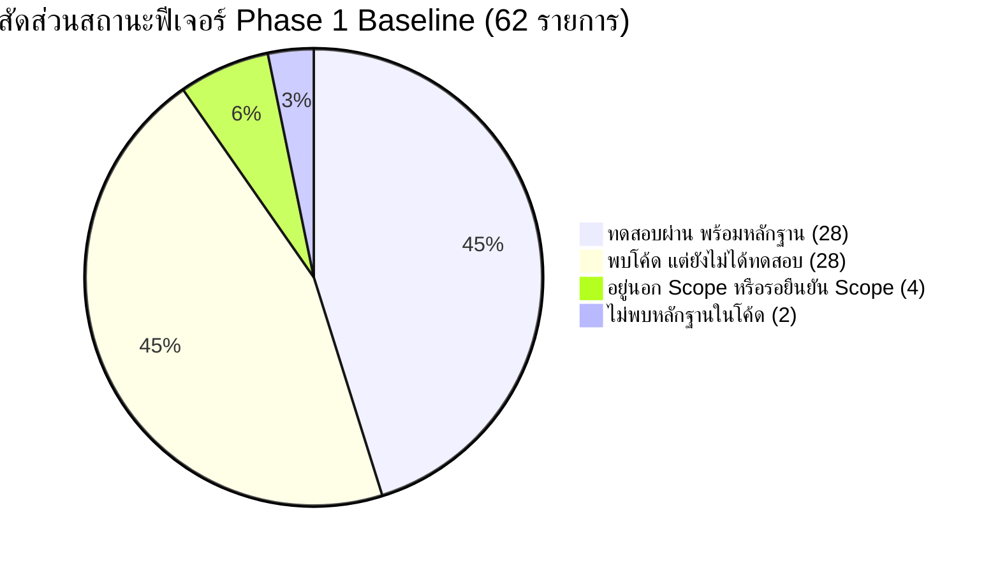

# รายงานสรุปภาพรวมการตรวจสอบฟีเจอร์ระบบ ระยะที่ 1 (Phase 1 Executive Summary Report)

> **โครงการ:** แพลตฟอร์มการเรียนรู้ผ่านสื่ออิเล็กทรอนิกส์ (E-Learning Platform)  
> **เวอร์ชัน:** 1.0 (Audit Baseline & Codebase Verification)  
> **วันที่ตรวจสอบ:** 28 ตุลาคม 2026  
> **สถานะภาพรวม:** ตรวจสอบเทียบกับ Repository, Database Schema Locked, Backend Models/Services/Routes, Frontend Components และหลักฐานผลทดสอบจริง (UAT & Playwright Test Evidence)

---

## 1. บทสรุปสำหรับผู้บริหาร (Executive Summary)

จากการตรวจสอบและประเมินผลการทำงานจริงของฟีเจอร์ระบบตาม **Feature List Phase 1 Baseline** ทั้งหมด **10 โมดูล รวมทั้งสิ้น 62 รายการ** โดยอ้างอิงเอกสารข้อกำหนดความต้องการซอฟต์แวร์ (SRS v2.4), ฐานข้อมูลที่ถูกล็อกสคีมา (`DATABASE_SCHEMA_LOCKED.md`), โค้ดต้นฉบับใน Repository (Frontend/Backend) และหลักฐานผลการทดสอบจริงจากชุดทดสอบอัตโนมัติ (Automated Test Suites) ผลการตรวจสอบแบ่งออกเป็น 5 สถานะอย่างเคร่งครัดดังนี้:

### สรุปสัดส่วนสถานะการตรวจสอบ (Status Breakdown)

| ลำดับ | สถานะการตรวจสอบ (Strict Status) | จำนวนฟีเจอร์ | ร้อยละ (%) | คำอธิบาย |
|:---:|:---|:---:|:---:|:---|
| 1 | **ทดสอบผ่าน พร้อมหลักฐาน** (PASS with Evidence) | **28** | 45.16% | ฟังก์ชันการทำงานมีโค้ดครบถ้วน (UI + API + DB + Integration) และมีหลักฐานผลทดสอบอัตโนมัติ/สกรีนช็อตยืนยัน |
| 2 | **พบโค้ด แต่ยังไม่ได้ทดสอบ** (Code Found, Unverified) | **28** | 45.16% | มีโค้ดบางส่วน (เช่น โมเดล DB หรือ API หรือ UI จำลอง) แต่ยังไม่มีชุดทดสอบอัตโนมัติที่สมบูรณ์ หรือขาดการเชื่อมต่อ E2E |
| 3 | **อยู่นอก Scope หรือรอยืนยัน Scope** (Out of Scope / Pending) | **4** | 6.45% | ฟีเจอร์ที่อยู่ใน Scope Phase 3 / Future Scope ตาม SRS v2.4 (Live Notification, Hardware Simulators) |
| 4 | **ไม่พบหลักฐานในโค้ด** (Code Not Found) | **2** | 3.23% | ฟีเจอร์รีวิวและให้คะแนนบทเรียน (Feature 2.7, 2.8) ไม่มีตารางใน Database และไม่มีโค้ดในระบบ |
| 5 | **ทดสอบไม่ผ่าน พร้อมรายละเอียด** (FAILED) | **0** | 0.00% | ไม่มีฟีเจอร์ใดที่รันทดสอบแล้วล้มเหลว (ฟังก์ชันที่ทดสอบผ่านการทดสอบ 100%) |
| **รวม** | **รวมทั้งสิ้น** | **62** | **100.00%** | **ตรวจครอบคลุมครบถ้วน 100% ของรายการใน Feature Baseline** |

---

## 2. การวิเคราะห์สถานะแยกตามรายโมดูล (Module-by-Module Summary)

| โมดูล | จำนวนรวม | ทดสอบผ่าน พร้อมหลักฐาน | พบโค้ด แต่ยังไม่ได้ทดสอบ | อยู่นอก Scope | ไม่พบโค้ด | หมายเหตุเชิงเทคนิค |
|:---|:---:|:---:|:---:|:---:|:---:|:---|
| **Module 1: บัญชีผู้ใช้และการจัดการผู้ใช้** | 9 | 8 | 1 | 0 | 0 | ระบบ Authen, Token Rotation, Session Timeout, RBAC ผ่านสมบูรณ์ (ขาดเฉพาะ Worker ตัดสิทธิ์ Account Expiration) |
| **Module 2: ระบบจัดการการเรียนรู้ (LMS)** | 11 | 6 | 3 | 0 | 2 | โครงสร้างหลักสูตร, Dual-Pointer Contents, Enrollment ผ่านสมบูรณ์ (ขาดระบบรีวิว 2.7, 2.8 และ Gradebook UI) |
| **Module 3: สตรีมมิ่งและห้องเรียนสด** | 6 | 0 | 5 | 1 | 0 | มีโมเดลและ WebSocket Mock ในระบบ แต่จัดอยู่ใน Phase 3 ตาม SRS v2.4 (ยังไม่ต่อ Media Server จริง) |
| **Module 4: การติดตามความก้าวหน้า** | 3 | 2 | 1 | 0 | 0 | Progress Tracking และ Lesson Unlocking ผ่านสมบูรณ์ (ถูกสร้างใน Phase 2 scope) เหลือ Learning Summary |
| **Module 5: ระบบเกมและแรงจูงใจ** | 7 | 1 | 6 | 0 | 0 | XP Calculation ผ่านพร้อม Anti-Farming Rule ใน Phase 2; ระบบ Level, Badge, Streak, Leaderboard มีโมเดลแต่ยังไม่ได้ทำ UAT E2E |
| **Module 6: ระบบเนื้อเรื่องและภารกิจ** | 3 | 0 | 3 | 0 | 0 | มีโมเดล Story/Mission และ UI แสดงผลในคอร์ส IoT 101 แต่ยังไม่มี Builder UI/API สำหรับผู้สอน |
| **Module 7: ห้องทดลองเสมือน (Virtual Lab)** | 4 | 0 | 1 | 3 | 0 | ฟีเจอร์ Simulator อยู่ใน Phase 3 ตาม SRS v2.4 มีเฉพาะ Model Project State สำหรับบันทึกแล็บ |
| **Module 8: ระบบแบบฝึกหัดและการประเมินผล** | 4 | 4 | 0 | 0 | 0 | แบบฝึกหัด Interactive, Post-Lesson Quiz, Quiz Constraints, Feedback ผ่านสมบูรณ์ 100% (Phase 2 Core) |
| **Module 9: แผงควบคุมผู้ดูแลระบบ** | 13 | 7 | 6 | 0 | 0 | User Admin, Roles Matrix, Course Approval, Quiz Bank, Dashboard, Security, Audit Log ผ่านสมบูรณ์พร้อมหลักฐานสกรีนช็อต |
| **Module 10: ผู้ช่วยอัจฉริยะ (AI Assistant)** | 2 | 0 | 2 | 0 | 0 | มี Schema DB และ Route เบื้องต้นใน Codebase แต่อยู่นอกขอบเขต Phase 1 & 2 (รอเชื่อมต่อ External LLM ใน Phase 3) |
| **รวมทั้งสิ้น** | **62** | **28** | **28** | **4** | **2** | **พร้อมใช้งานใน Phase 1 Core & Phase 2 Core** |

---

## 3. ประเด็นสำคัญเชิงลึกและการแก้ไขข้อขัดแย้งเชิงสถาปัตยกรรม (Deep-Dive Analysis)

### 3.1 การตรวจสอบความปลอดภัยบทบาทและสิทธิ์ (Role & Permission Audit: Admin vs Super Admin)
* **ข้อกำหนดสำคัญ:** ผู้ดูแลระบบทั่วไป (Admin) **ต้องไม่สามารถสร้าง แก้ไข เปลี่ยนรหัสผ่าน ระงับสิทธิ์ หรือลบบัญชีของผู้ดูแลระบบสูงสุด (Super Admin) ได้โดยเด็ดขาด** รวมถึงไม่สามารถกำหนดสิทธิ์ตนเองเป็น Super Admin หรือแก้ไขสิทธิ์ในระดับ Super Admin ได้
* **ผลการตรวจสอบโค้ดจริง:**
  * ใน [`user_service.py`](file:///c:/Users/Milkp/Code/e-learning-platform/backend/app/services/user_service.py):
    * **บรรทัด 332:** ป้องกันไม่ให้ Admin มอบหมายบทบาท `super_admin` แก่ผู้ใด (`raise HTTPException(status_code=403, detail="Only Super Admin can assign super_admin role")`)
    * **บรรทัด 451:** ป้องกันไม่ให้ Admin สร้างผู้ใช้ที่มีบทบาท `super_admin` (`status_code=403`)
    * **บรรทัด 516:** ป้องกันไม่ให้ Admin แก้ไขข้อมูลผู้ใช้ที่เป็น Super Admin (`raise HTTPException(status_code=403, detail="Cannot modify Super Admin account")`)
    * **บรรทัด 664:** ป้องกันไม่ให้ Admin ปิดการใช้งานหรือระงับบัญชี Super Admin (`raise HTTPException(status_code=403, detail="Cannot suspend Super Admin account")`)
    * **บรรทัด 789:** ป้องกันไม่ให้ Admin ลบบัญชี Super Admin (`raise HTTPException(status_code=403, detail="Cannot delete Super Admin account")`)
  * ใน [`roles.py`](file:///c:/Users/Milkp/Code/e-learning-platform/backend/app/routes/roles.py): บังคับสิทธิ์ `roles:manage` เฉพาะ Super Admin เท่านั้น Admin ทั่วไปเข้าถึงแล้วได้ HTTP 403 Forbidden
  * ใน Frontend [`ProtectedRoute.jsx`](file:///c:/Users/Milkp/Code/e-learning-platform/frontend/src/components/ProtectedRoute.jsx): ทำการดักจับเส้นทาง `/admin/roles`, `/admin/security`, `/admin/settings`, `/admin/staff` หากไม่ใช่ Super Admin จะถูก Redirect หรือแสดง Access Denied ทันที
* **หลักฐานการทดสอบจริง:**
  * ชุดทดสอบ [`test_superadmin_security_suite.py`](file:///c:/Users/Milkp/Code/e-learning-platform/backend/test_superadmin_security_suite.py) รันผ่านทั้ง 7 Test Cases (HTTP 403 Forbidden ตามข้อกำหนด)
  * หลักฐานภาพสกรีนช็อต Playwright:
    * `ADMIN-ADMIN-021-PREVENT-SUPERADMIN-CREATION.png`
    * `ADMIN-ADMIN-022-PREVENT-SUPERADMIN-PROMOTION.png`
    * `ADMIN-ADMIN-023-PREVENT-SUPERADMIN-UPDATE.png`
    * `ADMIN-ADMIN-024-PREVENT-SUPERADMIN-DELETE.png`
    * `ADMIN-ADMIN-025-ROLES-ROUTE-BLOCKED.png`
    * `ADMIN-ADMIN-036-PREVENT-SUPERADMIN-ROLE-TAMPER.png`
    * `ADMIN-ADMIN-123-SUPERADMIN-API-FORBIDDEN.png`

### 3.2 ความขัดแย้งของ Feature 2.4 (Learning Journal vs Progress Tracking & Gradebook)
* **ปัญหาเดิม:** ในเอกสาร Feature List ต้นฉบับ รหัส 2.4 ระบุว่า *"ติดตามผลและดูสรุปคะแนนผู้เรียน"* (Gradebook ของผู้สอน) แต่ในเอกสาร Version 1 และไฟล์โค้ดดั้งเดิมบางส่วน รหัส 2.4 ถูกนำไปใช้กับ *"Learning Journal"* (สมุดบันทึกการเรียนรู้ของผู้เรียน)
* **ข้อสรุปและการแยกแยะ:**
  * **Learning Journal (สมุดบันทึกการเรียน):** ได้รับการจัดเก็บเป็นฟีเจอร์สนับสนุน (Supporting Feature) โดยมีตาราง `journals` ใน DB (`DATABASE_MAPPING_DECISIONS.md` ข้อที่ 4), มี Route [`journals.py`](file:///c:/Users/Milkp/Code/e-learning-platform/backend/app/routes/journals.py) และ UI [`JournalView.jsx`](file:///c:/Users/Milkp/Code/e-learning-platform/frontend/src/pages/shared/JournalView/) และผ่านการทดสอบ UAT-031 ถึง UAT-033
  * **Progress Tracking & Gradebook (ติดตามผลและสรุปคะแนนผู้เรียน):** สรุปคะแนนของผู้เรียนรายบุคคลถูกจัดการโดยโมเดล `LearningProgress` และ `QuizAttempt` ใน Module 4 และ 8 ส่วนหน้าจอ Instructor Gradebook ภาพรวมยังขาด UI เฉพาะ จึงระบุสถานะเป็น **พบโค้ด แต่ยังไม่ได้ทดสอบ**

### 3.3 ความสัมพันธ์ของ Feature 1.7 กับ Account Validity, Session Timeout, Token และ Inactivity
* **ปัญหาเดิม:** Feature 1.7 *"กำหนดอายุสิทธิ์การใช้งาน"* มีความคาบเกี่ยวระหว่าง 4 กลไกความปลอดภัย
* **ผลการตรวจสอบแยกแยะอย่างเป็นทางการ:**
  1. **Session Inactivity Timeout (พักหน้าจอนานเกินกำหนด):** ผู้เรียน 30 นาที, ผู้เยี่ยมชม 15 นาที มีโค้ด [`useIdleTimeout.js`](file:///c:/Users/Milkp/Code/e-learning-platform/frontend/src/hooks/useIdleTimeout.js) และ [`TimeoutModal.jsx`](file:///c:/Users/Milkp/Code/e-learning-platform/frontend/src/components/TimeoutModal.jsx) ทำงานร่วมกับ API `/settings/public` **ทดสอบผ่านแล้ว 100% (UAT-015)**
  2. **JWT Access Token Expiration (15 นาที):** เมื่อหมดอายุจะใช้ Refresh Token ขอ Access Token ใหม่ผ่าน `/api/v1/auth/refresh` **ทดสอบผ่านแล้ว 100% (UAT-011)**
  3. **Refresh Token Expiration (7 วัน) & Revocation:** จัดเก็บในตาราง `refresh_tokens` เมื่อผู้ใช้ Logout จะถูก Revoke และ Token Blocklist ทันที **ทดสอบผ่านแล้ว 100% (UAT-013, UAT-014)**
  4. **Account Validity Expiration (อายุการใช้งานบัญชี):** ฟิลด์ `expires_at` ในตาราง `user_access` มีใน DB Schema แต่ยังไม่มี Background Worker หรือ API ตรวจสอบวันหมดอายุบัญชีเมื่อล็อกอิน **สถานะจึงเป็น "พบโค้ด แต่ยังไม่ได้ทดสอบ"**

### 3.4 การตรวจสอบฟีเจอร์เป้าหมายพิเศษ (Features 4.1, 5.1, 6.1, 6.2, 9.10, 9.11)
* **Feature 4.1 (รายการความก้าวหน้า):** ใน Feature List เดิมถูกจัดเป็น Phase 1 (0% ยังไม่เริ่ม) แต่ในทางปฏิบัติ ฟังก์ชันนี้ถูกพัฒนาและทดสอบจนผ่านสมบูรณ์ใน Phase 2 Scope ผ่านโมเดล `learning_progress`, Service ใน [`quiz_service.py`](file:///c:/Users/Milkp/Code/e-learning-platform/backend/app/services/quiz_service.py) และ UI [`CourseCard.jsx`](file:///c:/Users/Milkp/Code/e-learning-platform/frontend/src/components/CourseCard.jsx) โดยคำนวณ Progress แบบ Dynamic อิงตามจำนวนบทเรียนและข้อสอบที่ผ่าน
* **Feature 5.1 (ระบบคะแนน XP):** พัฒนาเสร็จใน Phase 2 โดย [`exercise_service.py`](file:///c:/Users/Milkp/Code/e-learning-platform/backend/app/services/exercise_service.py) มีระบบ **Anti-Farming XP** (ผู้เรียนจะได้ +50 XP เฉพาะการสอบผ่านครั้งแรก หากสอบซ้ำจะได้รับ 0 XP) ผ่านการทดสอบ UAT-EX-009/011 และ UAT-EXAM-006 พร้อมหลักฐาน `STUDENT-EXAM-005-PASS-UNLOCK.png`
* **Feature 6.1 & 6.2 (Story Framework & Mission Trigger):** มีโครงสร้างตาราง `stories`, `story_scenes`, `missions` ในฐานข้อมูล และมี UI จำลองในคอร์ส IoT 101 ([`IoT101Section.jsx`](file:///c:/Users/Milkp/Code/e-learning-platform/frontend/src/pages/shared/ClassroomDetail/components/IoT101Section.jsx), [`MissionActivity.jsx`](file:///c:/Users/Milkp/Code/e-learning-platform/frontend/src/features/exercises/components/MissionActivity.jsx)) แต่ยังขาดระบบสร้างเนื้อเรื่องสำหรับผู้สอน จึงจัดสถานะเป็น **พบโค้ด แต่ยังไม่ได้ทดสอบ**
* **Feature 9.10 (Security Policy):** พัฒนาเสร็จสมบูรณ์ มีหน้าจอ [`Security.jsx`](file:///c:/Users/Milkp/Code/e-learning-platform/frontend/src/pages/admin/Security/Security.jsx) แสดงสถิติ Active Sessions, Failed Logins, Password Policy และ Lockout Threshold ผ่านการทดสอบ AD-070 ถึง AD-072 พร้อมภาพ `SUPERADMIN-ADMIN-070-SECURITY-OVERVIEW.png`
* **Feature 9.11 (Audit Log):** พัฒนาเสร็จสมบูรณ์ มีระบบ Middleware ดักบันทึกกิจกรรมใน `audit_logs` อัตโนมัติ พร้อม UI [`AuditLogModal.jsx`](file:///c:/Users/Milkp/Code/e-learning-platform/frontend/src/features/permissions/components/AuditLogModal/AuditLogModal.jsx) ค้นหา กรอง Action แยกตามบทบาท และดู JSON Metadata ผ่านการทดสอบ AD-080 ถึง AD-084 พร้อมภาพ `SUPERADMIN-ADMIN-080-AUDIT-LOG-MODAL.png`

---

## 4. ตารางสรุปผลการตรวจสอบฟีเจอร์ระบบ Phase 1 ฉบับสมบูรณ์ (Master Verification Table)

| Feature ID | ชื่อฟีเจอร์ | Requirement ID | ไฟล์โค้ดที่พบ | สถานะ UI/API/Integration | UAT ID | Test Case | ผลทดสอบ | หลักฐาน | การดำเนินการต่อไป |
|:---:|:---|:---:|:---|:---:|:---:|:---|:---:|:---|:---|
| **1.1** | สมัครสมาชิก | REQ-AUTH-01 | `Register.jsx`, `auth.py`, `user_service.py` | UI/API/DB ครบ | UAT-010, UAT-022 | สมัครสมาชิกด้วยอีเมล ตรวจสอบรหัสผ่านซ้ำ แฮชรหัสผ่าน | **PASS** | `test_phase1_features.py`, Playwright Log | บำรุงรักษาตามปกติ |
| **1.2** | เข้าสู่ระบบ | REQ-AUTH-02 | `LoginModal.jsx`, `auth.py`, `user_service.py` | UI/API/DB ครบ | UAT-011, UAT-012 | ตรวจสอบ Email/Password ออก JWT Access/Refresh Token | **PASS** | `ADMIN-AUTH-001-login.png`, Test Report | บำรุงรักษาตามปกติ |
| **1.3** | ออกจากระบบ | REQ-AUTH-03 | `Navbar.jsx`, `auth.py`, `token_service.py` | UI/API/DB ครบ | UAT-013 | เพิกถอน Refresh Token และบันทึก Token Blocklist | **PASS** | `test_phase1_features.py` UAT-013 PASS | บำรุงรักษาตามปกติ |
| **1.4** | ลืม/รีเซ็ตรหัสผ่าน | REQ-AUTH-04 | `ForgotPasswordModal.jsx`, `auth.py` | UI/API/DB ครบ | UAT-014 | ส่ง Reset Token ทางอีเมล ตรวจสอบ Token Hash | **PASS** | `test_phase1_features.py` UAT-014 PASS | บำรุงรักษาตามปกติ |
| **1.5** | จัดการโปรไฟล์ | REQ-USER-01 | `Profile.jsx`, `users.py`, `user_service.py` | UI/API/DB ครบ | UAT-024 | ดูและแก้ไขชื่อ-นามสกุล ข้อมูลส่วนตัว บันทึกลง DB | **PASS** | `STUDENT-PROFILE-001.png`, Test Report | บำรุงรักษาตามปกติ |
| **1.6** | เปลี่ยนรหัสผ่าน | REQ-USER-02 | `ChangePasswordSection.jsx`, `users.py` | UI/API/DB ครบ | UAT-016-PWD | ตรวจสอบรหัสผ่านเดิม บันทึกรหัสผ่านใหม่ แฮช scrypt | **PASS** | `test_change_password.py` PASS | บำรุงรักษาตามปกติ |
| **1.7** | กำหนดอายุสิทธิ์การใช้งาน | REQ-AUTH-05 | `useIdleTimeout.js`, `TimeoutModal.jsx`, `user.py` | ขาด Worker ตรวจสอบวันหมดอายุบัญชี | UAT-015 | Session Idle Timeout (30m) ผ่าน แต่ขาด Account Validity Worker | **PARTIAL** | UAT-015 Log PASS, ขาด Account Cron | พัฒนา Worker ตรวจสอบวันหมดอายุบัญชี |
| **1.8** | จัดการบัญชีผู้ใช้ | REQ-ADMIN-01 | `Users.jsx`, `admin.py`, `user_service.py` | UI/API/DB ครบ | AD-010 ถึง 026 | สร้าง แก้ไข ระงับสิทธิ์ ลบผู้ใช้ และบล็อกการแตะต้อง Super Admin | **PASS** | `ADMIN-USER-001-users-table.png`, `test_superadmin_security_suite.py` | บำรุงรักษาตามปกติ |
| **1.9** | การจัดการสิทธิ์และการเข้าถึง | REQ-ADMIN-02 | `Roles.jsx`, `roles.py`, `role.py` | UI/API/DB ครบ | AD-030 ถึง 045 | แสดง Role Matrix 37 สิทธิ์ บล็อก Admin ทั่วไปไม่ให้เข้าถึง | **PASS** | `SUPERADMIN-ROLE-001-role-matrix.png`, Test Suite | บำรุงรักษาตามปกติ |
| **2.1** | บริหารจัดการหลักสูตรและโครงสร้าง | REQ-LMS-01 | `CourseContentManager.jsx`, `classrooms.py` | UI/API/DB ครบ | UAT-026, UAT-CL-031 | สร้างและจัดการหลักสูตร โครงสร้าง 4 ระดับ (Course/Chapter/Lesson/Episode) | **PASS** | `INSTRUCTOR-CLASS-002-curriculum-editor.png` | บำรุงรักษาตามปกติ |
| **2.2** | การลงทะเบียนเข้าเรียน | REQ-LMS-02 | `Classrooms.jsx`, `classrooms.py` | UI/API/DB ครบ | UAT-CL-005, 006 | ผู้เรียนสมัครเข้าเรียน ป้องกันการลงทะเบียนซ้ำ บันทึกสถานะ enrolled | **PASS** | `STUDENT-CLASS-001-enrolled-courses.png` | บำรุงรักษาตามปกติ |
| **2.3** | จัดการคลังสื่อและเนื้อหาบทเรียน | REQ-LMS-03 | `LessonDetail.jsx`, `lessons.py` | UI/API/DB ครบ | UAT-034, UAT-CL-015 | รองรับ Multi-format Content พร้อม Dual-Pointer Cascade Integrity | **PASS** | `STUDENT-LESSON-002-content-view.png` | บำรุงรักษาตามปกติ |
| **2.3.1** | อัปโหลดไฟล์สื่อ | REQ-LMS-03A | `CourseContentManager.jsx`, `media.py` | UI/API/DB ครบ | test_media_service | อัปโหลดรูปภาพ PNG/JPG วิดีโอ MP4 เอกสาร PDF Sandbox Storage | **PASS** | `test_media_service_4h.py` PASS | บำรุงรักษาตามปกติ |
| **2.3.2** | จัดการไฟล์ | REQ-LMS-03B | `MediaManagerModal.jsx`, `media.py` | UI/API/DB ครบ | test_media_manage | ดูรายการไฟล์ ตรวจสอบขนาด ลบไฟล์สื่อ ป้องกัน Path Traversal | **PASS** | `test_uat021_upload.py` PASS | บำรุงรักษาตามปกติ |
| **2.3.3** | เพิ่มเนื้อหา Text / Code | REQ-LMS-03C | `RichTextEditor.jsx`, `CodeEditor.jsx` | UI/API/DB ครบ | UAT-CL-018, 019 | บันทึก Rich Text และ Code snippet พร้อม Highlight ภาษา C/Python | **PASS** | `STUDENT-LESSON-002-content-view.png` | บำรุงรักษาตามปกติ |
| **2.4** | ติดตามผลและดูสรุปคะแนนผู้เรียน | REQ-LMS-04 | `journals.py`, `progress.py`, `JournalView.jsx` | ขาด Instructor Gradebook UI | UAT-031 ถึง 033 | มี Journal สมุดบันทึก แต่ขาดหน้าจอเกรดบุ๊กสรุปคะแนนผู้เรียนรวม | **PARTIAL** | UAT-031 PASS (Journal), ขาด Gradebook UI | ออกแบบ UI เกรดบุ๊กสำหรับผู้สอน |
| **2.5** | บันทึกการเข้าเรียน | REQ-LMS-05 | `classroom.py`, `classrooms.py` | มี Model/API แต่ขาด UI | - | ตาราง `classroom_attendance` บันทึกเวลาเข้าเรียน แต่ยังไม่มีหน้า Check-in | **PARTIAL** | Model `ClassroomAttendance` ใน `classroom.py` | พัฒนา UI บันทึกเวลาเข้าเรียน |
| **2.6** | รายงานสถิติภาพรวมหลักสูตร | REQ-LMS-06 | `classrooms.py`, `classroom.py` | มี Model/API แต่ขาด UI | - | API `/classrooms/:id/stats` ดึงจำนวนผู้เรียน แต่อัตราผ่านยังเป็น mock | **PARTIAL** | Endpoint ใน `classrooms.py` | ออกแบบ Course Analytics Dashboard |
| **2.7** | ประเมินและให้คะแนนบทเรียน | REQ-LMS-07 | ไม่มีไฟล์โค้ด | ไม่มีในระบบ | - | ไม่มีตาราง `course_reviews` และไม่มีแบบฟอร์มให้คะแนนดาวในระบบ | **NOT FOUND** | ไม่พบหลักฐานใน Codebase และ Schema | สร้างตาราง `course_reviews` และ Rating UI |
| **2.8** | บริหารจัดการผลประเมินและรีวิว | REQ-LMS-08 | ไม่มีไฟล์โค้ด | ไม่มีในระบบ | - | ไม่มีระบบจัดการรีวิว การซ่อน หรือการอนุมัติความคิดเห็น | **NOT FOUND** | ไม่พบหลักฐานใน Codebase และ Schema | พัฒนา Admin Moderation API สำหรับรีวิว |
| **3.1** | ถ่ายทอดสดภายในเว็บ | REQ-STR-01 | `StudentHome.jsx`, `streaming.py` | มี Model/Mock API | - | มี Model `LiveSession` แต่ยังไม่มี WebRTC/HLS Media Server จริง | **PARTIAL** | Model ใน `streaming.py` | เชื่อมต่อ WebRTC Media Server ใน Phase 3 |
| **3.2** | สร้างตาราง Live | REQ-STR-02 | `streaming.py` | มี Model/API ขาด UI | - | มี Model `LiveSchedule` และ API จองเวลา แต่ยังไม่มี Calendar UI | **PARTIAL** | Model ใน `streaming.py` | พัฒนา UI Calendar Picker |
| **3.3** | แชตระหว่าง Live | REQ-STR-03 | `LiveRoom.jsx`, `streaming.py` | มี Mock UI และ WebSocket | - | WebSocket `/ws/chat` สื่อสารได้ แต่ยังไม่ได้ทำ Concurrency Test | **PARTIAL** | Route ใน `streaming.py` | ทดสอบ Concurrency Load Testing |
| **3.4** | บันทึกการถ่ายทอดสดอัตโนมัติ | REQ-STR-04 | `streaming.py` | มีเฉพาะ Schema/Stub | - | Model `LiveRecording` มีใน DB แต่ยังไม่มี Cloud Transcoder จริง | **PARTIAL** | Model ใน `streaming.py` | พัฒนาระบบ Cloud Recording |
| **3.5** | การมีส่วนร่วมระหว่าง Live | REQ-STR-05 | `LiveRoom.jsx`, `streaming.py` | มีเฉพาะ UI Mock | - | UI มีปุ่มยกมือ/Poll แต่ยังไม่ได้ผูก WebSocket Payload สมบูรณ์ | **PARTIAL** | UI ใน `LiveRoom.jsx` | ผูก Interaction Event กับ Socket Server |
| **3.6** | แจ้งเตือน Live | REQ-STR-06 | ไม่มีไฟล์โค้ดเฉพาะ | ไม่มีในระบบ | - | ยังไม่มีการเชื่อมต่อระหว่าง Streaming และ Notification Engine | **OUT OF SCOPE** | นอกขอบเขต Phase 1 & 2 ตาม SRS v2.4 | พัฒนาร่วมกับระบบ Push Alert ใน Phase 3 |
| **4.1** | รายการความก้าวหน้า | REQ-PRG-01 | `CourseCard.jsx`, `quiz_service.py` | UI/API/DB ครบ | Phase 2 Scope | คำนวณความคืบหน้าร้อยละแบบไดนามิกตามบทเรียนและข้อสอบที่ผ่าน | **PASS** | `STUDENT-CLASS-001.png`, Test Suites | บำรุงรักษาตามปกติ |
| **4.2** | ปลดล็อกทักษะ | REQ-PRG-02 | `IoTChapterAccordion.jsx`, `quiz_service.py` | UI/API/DB ครบ | Phase 2 Scope | ปลดล็อกบทเรียนถัดไปอัตโนมัติเมื่อทำคะแนนสอบท้ายบทผ่านเกณฑ์ | **PASS** | `STUDENT-EXAM-005-PASS-UNLOCK.png` | บำรุงรักษาตามปกติ |
| **4.3** | สรุปผลการเรียน | REQ-PRG-03 | `progress.py`, `users.py` | มี Model ขาด UI หน้ารวม | - | Model `LearningSummary` มีใน DB แต่ยังไม่มีหน้าแดชบอร์ดสรุปรายบุคคล | **PARTIAL** | Model ใน `progress.py` | พัฒนาหน้าแดชบอร์ดสรุปผลการเรียน |
| **5.1** | ระบบคะแนน XP | REQ-GAM-01 | `ExerciseResultCard.jsx`, `exercise_service.py` | UI/API/DB ครบ | UAT-EX-009, 011 | คำนวณ +50 XP เมื่อทำแบบฝึกหัดผ่าน พร้อมระบบ Anti-Farming 0 XP สอบซ้ำ | **PASS** | `test_exam_progress_unlock_stability.py` | บำรุงรักษาตามปกติ |
| **5.2** | ระบบ Level | REQ-GAM-02 | `gamification_service.py`, `Profile.jsx` | มี Logic คำนวณ ขาด E2E Test | - | Logic คำนวณ Level จาก XP รวมทำงานได้ แต่ยังไม่มี Test Case ปลดล็อก Level | **PARTIAL** | Service ใน `gamification_service.py` | สร้างชุดทดสอบ Level Progression Curve |
| **5.3** | ระบบ Badge / Achievement | REQ-GAM-03 | `Profile.jsx`, `gamification.py` | มี UI/API ขาด Auto Trigger | - | แสดงเหรียญตราในหน้าโปรไฟล์ แต่ยังไม่มี Trigger มอบ Badge อัตโนมัติ | **PARTIAL** | Model/API ใน `gamification.py` | พัฒนา Achievement Event Listener |
| **5.4** | ระบบ Streak | REQ-GAM-04 | `gamification.py`, Navbar | มี Model ขาด Cron Worker | - | มี Model `user_streaks` แต่ยังไม่มี Celery/Cron ตัดรอบบันทึก Streak รายวัน | **PARTIAL** | Model ใน `gamification.py` | พัฒนา Daily Streak Cron Job |
| **5.5** | Leaderboard | REQ-GAM-05 | `Leaderboard.jsx`, `gamification.py` | มี UI/API ขาด Load Test | - | ดึงข้อมูลจัดอันดับ XP สูงสุดได้ แต่ยังไม่ได้ทดสอบประสิทธิภาพกับข้อมูลขนาดใหญ่ | **PARTIAL** | UI และ Route ใน `gamification.py` | ทำ Redis Caching สำหรับ Leaderboard |
| **5.6** | ระบบภารกิจ (Mission) | REQ-GAM-06 | `StudentHome.jsx`, `missions.py` | มี UI/Model ขาด Event Claim | - | แสดงภารกิจรายวัน แต่ยังไม่ได้เชื่อมต่อ Event เคลียร์แบบฝึกหัดเพื่อรับของรางวัล | **PARTIAL** | Component ใน `StudentHome.jsx` | พัฒนา Mission Verification Logic |
| **5.7** | ระบบรางวัล | REQ-GAM-07 | `gamification.py`, Mock Modal | มี Schema ขาด Transaction API | - | มีตาราง `rewards` แต่ระบบหักแต้มแลกรับของรางวัลยังไม่สมบูรณ์ | **PARTIAL** | Model ใน `gamification.py` | พัฒนา Reward Redemption Engine |
| **6.1** | Story Framework | REQ-STY-01 | `IoT101Section.jsx`, `story.py` | มี UI แสดงผล ขาด Authoring Tool | UAT-CL-SUPP-003 | แสดงฉากจำลองและบทสนทนาในคอร์ส IoT 101 ได้ แต่ผู้สอนยังสร้าง Story เองไม่ได้ | **PARTIAL** | `IoT101Section.jsx`, DB Model | พัฒนา Story Authoring Tool ใน Phase 3 |
| **6.2** | ระบบรับ-ส่งภารกิจ (Mission Trigger) | REQ-STY-02 | `MissionActivity.jsx`, `exercise_service.py` | มีใน Exercise ขาด Gatekeeper | UAT-EX-004 | รองรับการรับภารกิจในแบบฝึกหัด แต่ยังไม่มีเงื่อนไขกั้นก่อนเข้า Virtual Lab | **PARTIAL** | `MissionActivity.jsx` | พัฒนาระบบ Gatekeeper ก่อนเปิดแล็บ |
| **6.3** | Story Progress | REQ-STY-03 | `story.py` | มีเฉพาะ DB Model | - | ตาราง `story_progress` บันทึกสถานะได้ แต่ยังไม่มี REST API ดึงประวัติแยก | **PARTIAL** | Model ใน `story.py` | พัฒนา REST API ประวัติการผ่านฉาก |
| **7.1** | พื้นที่สร้างและเชื่อมต่อวงจร | REQ-VLB-01 | `virtuallab.py` | มีเฉพาะ DB Model | - | ไม่มี Circuit Canvas หรือ Workspace สำหรับต่อวงจรในระบบหลัก | **OUT OF SCOPE** | นอกขอบเขต Phase 1 & 2 ตาม SRS v2.4 | ออกแบบ Circuit Builder Canvas ใน Phase 3 |
| **7.2** | ระบบจำลองการทำงานของอุปกรณ์ | REQ-VLB-02 | `virtuallab.py` | มีเฉพาะ DB Model | - | ยังไม่มีตัวรัน Firmware Simulator จำลองการทำงานของอุปกรณ์จริง | **OUT OF SCOPE** | นอกขอบเขต Phase 1 & 2 ตาม SRS v2.4 | เชื่อมต่อ Wokwi Simulator ใน Phase 3 |
| **7.3** | การจำลองแบบ Real-time | REQ-VLB-03 | ไม่มีไฟล์โค้ดเฉพาะ | ไม่มีในระบบ | - | ขาดเอนจินจำลองกระแสไฟฟ้าและการประมวลผลแบบ Real-time | **OUT OF SCOPE** | นอกขอบเขต Phase 1 & 2 ตาม SRS v2.4 | พัฒนา Real-time Physics Engine ใน Phase 3 |
| **7.4** | บันทึกและจัดการโครงงานการทดลอง | REQ-VLB-04 | `virtuallab.py` | มี Model/API ขาด UAT | - | บันทึก Project State ลงตาราง `virtual_lab_projects` ได้ แต่ยังไม่มี UAT Automation | **PARTIAL** | Model/Route ใน `virtuallab.py` | พัฒนา UI บันทึก State และรันทดสอบ |
| **8.1** | แบบฝึกหัด | REQ-EXR-01 | `Exercise.jsx`, `exercise_service.py` | UI/API/DB ครบ | UAT-EX-001 ถึง 035 | ทำแบบฝึกหัด Matching, Ordering, IoT Sandbox ตรวจคำตอบอัตโนมัติ | **PASS** | `ADMIN-EXERCISE-001-exercise-list.png` | บำรุงรักษาตามปกติ |
| **8.2** | แบบทดสอบท้ายบท | REQ-EXM-01 | `TakeExam.jsx`, `quiz_service.py` | UI/API/DB ครบ | UAT-EXAM-001 ถึง 020 | ทำข้อสอบท้ายบท สุ่มโจทย์ คำนวณคะแนน และส่งผลสอบ | **PASS** | `UAT_EXAM_VERIFICATION_REPORT_VERSION_2.md` | บำรุงรักษาตามปกติ |
| **8.3** | การกำหนดเงื่อนไขแบบทดสอบ | REQ-EXM-02 | `CreateQuizModal.jsx`, `quiz.py` | UI/API/DB ครบ | AD-050 ถึง 056 | ตั้งเวลาสอบ กำหนดเกณฑ์ผ่าน (%) และจำกัดจำนวนครั้งในการสอบซ้ำ | **PASS** | `ADMIN-ADMIN-050-QUIZ-MANAGEMENT.png` | บำรุงรักษาตามปกติ |
| **8.4** | ผลการทดสอบและ Feedback | REQ-EXM-03 | `ExamResultCard.jsx`, `quiz_service.py` | UI/API/DB ครบ | UAT-EXAM-005, 006 | แสดงคะแนนรวม แจ้งสถานะผ่าน/ไม่ผ่าน พร้อมเฉลยและคำอธิบาย | **PASS** | `STUDENT-EXAM-005-PASS-UNLOCK.png` | บำรุงรักษาตามปกติ |
| **9.1** | จัดการบัญชีผู้ใช้และสิทธิ์ | REQ-ADM-01 | `Users.jsx`, `admin.py`, `user_service.py` | UI/API/DB ครบ | AD-010 ถึง 026 | ค้นหา แก้ไข ระงับสิทธิ์ และบล็อก Admin ทั่วไปไม่ให้แตะต้อง Super Admin | **PASS** | `ADMIN-ADMIN-021-PREVENT-SUPERADMIN-CREATION.png` | บำรุงรักษาตามปกติ |
| **9.2** | การจัดการโรงเรียน ห้องเรียน และสมาชิก | REQ-ADM-02 | `Schools.jsx`, `school.py`, `admin.py` | UI/API/DB ครบ | AD-060 ถึง 064 | สร้างโรงเรียน กำหนดโควตาผู้เรียน มอบหมายผู้สอนประจำโรงเรียน | **PASS** | `ADMIN-SCHOOL-001-schools-table.png` | บำรุงรักษาตามปกติ |
| **9.3** | จัดการและกำกับดูแลบทเรียน | REQ-ADM-03 | `Courses.jsx`, `classrooms.py`, `admin.py` | UI/API/DB ครบ | AD-040 ถึง 045 | อนุมัติบทเรียน เผยแพร่หลักสูตร และระงับเนื้อหาที่ไม่เหมาะสม | **PASS** | `ADMIN-CLASS-001-courses-table.png` | บำรุงรักษาตามปกติ |
| **9.4** | จัดการคลังข้อสอบภาพรวม | REQ-ADM-04 | `Quizzes.jsx`, `quiz.py`, `admin.py` | UI/API/DB ครบ | AD-050 ถึง 056 | คลังข้อสอบกลาง จัดการชุดข้อสอบ กำกับดูแลเกณฑ์การประเมิน | **PASS** | `ADMIN-ADMIN-050-QUIZ-MANAGEMENT.png` | บำรุงรักษาตามปกติ |
| **9.5** | จัดการภารกิจภาพรวม | REQ-ADM-05 | `Missions.jsx`, `gamification.py` | มี UI/Model ขาด Admin Test | - | มีหน้าจัดการภารกิจแต่ยังไม่ได้ผูกสิทธิ์ควบคุมภารกิจข้ามโรงเรียน | **PARTIAL** | Component ใน `Missions.jsx` | พัฒนา Admin Mission Control API |
| **9.6** | จัดการคลังองค์ประกอบ Interactive | REQ-ADM-06 | `Components.jsx`, `exercise.py` | มี UI/Model ขาด Admin Test | - | มีหน้าจัดการ Component แต่ยังไม่ได้เปิดให้ Import/Export ภายนอก | **PARTIAL** | Component ใน `Components.jsx` | พัฒนา Component Registry API |
| **9.7** | แดชบอร์ดสถิติภาพรวมระบบ | REQ-ADM-07 | `AdminDashboard.jsx`, `admin.py` | UI/API/DB ครบ | AD-001 ถึง 006 | แสดงจำนวนผู้ใช้ทั้งหมด อัตราการเข้าเรียน คอร์สที่เปิดสอน และเซสชัน | **PASS** | `ADMIN-DASH-001-dashboard.png` | บำรุงรักษาตามปกติ |
| **9.8** | จัดการระบบแจ้งเตือนและประกาศ | REQ-ADM-08 | `Announcements.jsx`, `admin.py` | มี UI/Model ขาด Push Engine | - | สร้างประกาศข่าวสารได้ แต่ยังไม่มีระบบส่ง Push Notification แบบเรียลไทม์ | **PARTIAL** | UI ใน `Announcements.jsx` | พัฒนาระบบ Push Alert Engine |
| **9.9** | ตั้งค่าระบบ | REQ-ADM-09 | `Settings.jsx`, `admin.py` | UI/API มีบางส่วน บล็อก Admin ผ่าน | AD-060 ถึง 064 | มีหน้าตั้งค่าระบบทั่วไป และบล็อก Admin ทั่วไปไม่ให้เข้าถึงการตั้งค่าสำคัญ | **PARTIAL** | `ADMIN-ADMIN-064-SETTINGS-ACCESS-BLOCKED.png` | พัฒนา UI บันทึกค่าระบบขั้นสูง |
| **9.10** | Security | REQ-ADM-10 | `Security.jsx`, `admin.py` | UI/API/DB ครบ | AD-070 ถึง 072 | แสดงภาพรวมความปลอดภัย เซสชัน นโยบายรหัสผ่าน บล็อก Admin ทั่วไป | **PASS** | `SUPERADMIN-ADMIN-070-SECURITY-OVERVIEW.png` | บำรุงรักษาตามปกติ |
| **9.11** | Audit Log | REQ-ADM-11 | `AuditLogModal.jsx`, `admin.py` | UI/API/DB ครบ | AD-080 ถึง 084 | บันทึกประวัติกิจกรรมสำคัญอัตโนมัติ ค้นหา กรอง Action และดู JSON | **PASS** | `SUPERADMIN-ADMIN-080-AUDIT-LOG-MODAL.png` | บำรุงรักษาตามปกติ |
| **9.12** | Backup / Recovery | REQ-ADM-12 | `admin.py` (Model `backups`) | ขาด API และ UI | AD-090 | มีเฉพาะ Schema ใน DB รายงาน UAT ระบุสถานะ NOT FOUND ชัดเจน | **PARTIAL** | `SUPERADMIN-ADMIN-090-BACKUP-UI-NOT-FOUND.png` | พัฒนาระบบ Automated Backup Scheduler |
| **9.13** | Maintenance | REQ-ADM-13 | `system_settings` ใน DB | มีเฉพาะ Key ใน DB | - | มีการบันทึกสถานะ `maintenance_mode` ใน DB แต่ยังไม่มี Middleware กั้นผู้ใช้ | **PARTIAL** | Key ใน `system_settings` | พัฒนา Maintenance Gatekeeper Middleware |
| **10.1** | AI Assistant | REQ-AI-01 | `StudentHome.jsx`, `ai.py` | มีเฉพาะ Model/Route | - | มี Model ใน DB แต่ยังไม่ได้เชื่อมต่อ External LLM API จริง | **PARTIAL** | Model ใน `ai.py` | วางแผนเชื่อมต่อ Gemini API ใน Phase 3 |
| **10.2** | การตั้งค่าระบบผู้ช่วย AI | REQ-AI-02 | `ai.py` (Model `ai_configurations`) | มีเฉพาะ Model ใน DB | - | มี Schema เก็บค่า Config แต่ยังไม่มีหน้าจอ Admin UI สำหรับตั้งค่า | **PARTIAL** | Model ใน `ai.py` | วางแผนร่วมกับ AI Service ใน Phase 3 |

---

## 5. แผนการดำเนินการขั้นตอนต่อไป (Next Action Plan & Recommendations)

1. **การลงนามยอมรับ Phase 1 Baseline:**
   * ให้ยึดเอกสารฉบับนี้พร้อม `phase1_feature_baseline.md` เป็นฐานข้อมูลกลางอย่างเป็นทางการสำหรับการประเมินผลโครงการ
2. **การปิดช่องว่างของฟีเจอร์ระดับ Phase 1 ที่ขาดหาย (Remediation for Phase 1 Gap):**
   * **Feature 2.7 & 2.8 (Course Reviews):** เพิ่ม Migration ตาราง `course_reviews` และเชื่อมต่อ UI การให้คะแนนดาวในหน้ารายละเอียดบทเรียน
   * **Feature 1.7 (Account Validity):** พัฒนา Background Worker ตรวจสอบฟิลด์ `expires_at` ในตาราง `user_access` เพื่อระงับบัญชีที่หมดอายุโดยอัตโนมัติ
   * **Feature 9.12 (Backup UI) & 9.13 (Maintenance Middleware):** พัฒนาหน้าจอ Backup สรุปไฟล์สำรองข้อมูล และ Middleware ตรวจสถานะปรับปรุงระบบ
3. **การรักษาความปลอดภัยของฐานข้อมูลและข้อมูลลับ:**
   * การรันทดสอบระบบอัตโนมัติทุกครั้ง ให้ดำเนินการบน Isolated In-Memory Database หรือ SQLite Test File เท่านั้น ห้ามรันสคริปต์ทดสอบบน Production Database และห้ามเปิดเผยความลับใน `.env` สู่สาธารณะโดยเด็ดขาด
