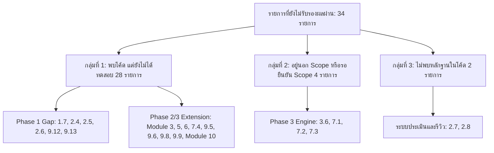

# รายงานรายการฟีเจอร์ที่ยังยืนยันไม่ได้และแนวทางแก้ไข (Phase 1 Unverified Features & Remediation Plan)

> **โครงการ:** แพลตฟอร์มการเรียนรู้ผ่านสื่ออิเล็กทรอนิกส์ (E-Learning Platform)  
> **เวอร์ชัน:** 1.0  
> **วันที่จัดทำ:** 28 ตุลาคม 2026  
> **วัตถุประสงค์:** รวบรวมและวิเคราะห์รายการคุณสมบัติที่ยังไม่ผ่านการทดสอบสมบูรณ์ ทั้งหมด **34 รายการ** (พบโค้ดแต่ยังไม่ได้ทดสอบ 28 รายการ, อยู่นอก Scope 4 รายการ, ไม่พบหลักฐานในโค้ด 2 รายการ) พร้อมระบุไฟล์โค้ดที่พบ สาเหตุที่ยังยืนยันไม่ได้ ผลกระทบเชิงความเสี่ยง และข้อกำหนดการแก้ไขทางเทคนิค

---

## 1. ภาพรวมรายการที่ยังยืนยันไม่ได้ (Unverified Features Summary)

จากการตรวจสอบ Baseline ทั้งหมด 62 รายการ พบว่ามี 28 รายการที่ผ่านการทดสอบสมบูรณ์พร้อมหลักฐาน (45.16%) และมี **34 รายการที่ยังไม่สามารถรับรองผลผ่านได้** แบ่งออกเป็น 3 กลุ่มดังนี้:

---

## 2. กลุ่มที่ 1: พบโค้ด แต่ยังไม่ได้ทดสอบ (Code Found, Unverified — 28 รายการ)

รายการในกลุ่มนี้มีโค้ดบางส่วนปรากฏอยู่ใน Repository (เช่น มี Database Model, มี REST API Route หรือมี UI จำลอง) แต่ยังขาดองค์ประกอบที่จำเป็นสำหรับการทำงานจริง หรือยังไม่มีชุดทดสอบอัตโนมัติ E2E มารับรองผล:

### 2.1 ช่องว่างสำคัญในขอบเขต Phase 1 (Phase 1 Core Gaps)

#### 1. Feature 1.7: กำหนดอายุสิทธิ์การใช้งาน (Account Validity Expiration)
* **บทบาทที่เกี่ยวข้อง:** Super Admin
* **ไฟล์โค้ดที่พบใน Repo:**
  * Model: ฟิลด์ `expires_at` ในคลาส `UserAccess` ใน [`backend/app/models/user.py#L199`](file:///c:/Users/Milkp/Code/e-learning-platform/backend/app/models/user.py#L199)
  * Frontend: [`useIdleTimeout.js`](file:///c:/Users/Milkp/Code/e-learning-platform/frontend/src/hooks/useIdleTimeout.js) และ [`TimeoutModal.jsx`](file:///c:/Users/Milkp/Code/e-learning-platform/frontend/src/components/TimeoutModal.jsx)
* **สิ่งที่ขาดหาย / สาเหตุที่ยังยืนยันไม่ได้:**
  * แม้ว่า Session Idle Timeout (30 นาที) และ Token Timeout จะทดสอบผ่านสมบูรณ์ 100% แต่การกำหนดอายุการใช้งานของบัญชี (เช่น บัญชีมีอายุใช้งาน 1 ปีแล้วต้องปิดการใช้งานอัตโนมัติ) **ยังไม่มี Background Cron Worker หรือ API Middleware ตรวจสอบค่า `expires_at` ขณะผู้ใช้ล็อกอิน**
* **ระดับความเสี่ยง:** ปานกลาง (Medium Risk — บัญชีที่หมดอายุอาจยังเข้าใช้งานได้หากผู้ดูแลไม่กดระงับสิทธิ์ด้วยตนเอง)
* **แนวทางแก้ไขทางเทคนิค (Remediation):**
  1. เพิ่มเงื่อนไขตรวจสอบ `user_access.expires_at < datetime.utcnow()` ในฟังก์ชัน `authenticate_user()` ใน [`user_service.py`](file:///c:/Users/Milkp/Code/e-learning-platform/backend/app/services/user_service.py) หากหมดอายุให้ส่ง HTTP 403 "Account expired"
  2. พัฒนา Celery/APScheduler Task ตรวจสอบและอัปเดตสถานะผู้ใช้เป็น `is_active=False` เมื่อถึงวันหมดอายุ
  3. เพิ่มแบบฟอร์มเลือกวันหมดอายุบัญชีใน [`Users.jsx`](file:///c:/Users/Milkp/Code/e-learning-platform/frontend/src/pages/admin/Users/Users.jsx)

#### 2. Feature 2.4: ติดตามผลและดูสรุปคะแนนผู้เรียน (Instructor Gradebook)
* **บทบาทที่เกี่ยวข้อง:** Instructor, Admin, Super Admin
* **ไฟล์โค้ดที่พบใน Repo:**
  * Model: `LearningProgress` ใน [`progress.py`](file:///c:/Users/Milkp/Code/e-learning-platform/backend/app/models/progress.py), `QuizAttempt` ใน [`quiz.py`](file:///c:/Users/Milkp/Code/e-learning-platform/backend/app/models/quiz.py)
  * Supporting: [`journals.py`](file:///c:/Users/Milkp/Code/e-learning-platform/backend/app/routes/journals.py) และ [`JournalView.jsx`](file:///c:/Users/Milkp/Code/e-learning-platform/frontend/src/pages/shared/JournalView/) (UAT-031 ถึง 033)
* **สิ่งที่ขาดหาย / สาเหตุที่ยังยืนยันไม่ได้:**
  * โค้ดเดิมถูกเข้าใจซ้ำซ้อนกับ Learning Journal ส่วนระบบ Gradebook สำหรับผู้สอนที่ต้องรวบรวมคะแนนสอบและการส่งงานของนักเรียนทั้งห้องเรียนมาแสดงเป็นตารางสรุปเกรดยังไม่มี UI สำหรับผู้สอน
* **ระดับความเสี่ยง:** ปานกลาง (Medium Risk — ผู้สอนตรวจสอบความก้าวหน้ารายบุคคลได้ แต่ยังดูภาพรวมทั้งห้องไม่ได้)
* **แนวทางแก้ไขทางเทคนิค (Remediation):**
  1. สร้าง REST Endpoint `GET /api/v1/classrooms/:id/gradebook` ดึงรายชื่อนักเรียน คะแนนแบบฝึกหัด และคะแนนสอบท้ายบททั้งหมด
  2. พัฒนาหน้าจอ `GradebookView.jsx` แสดงตาราง Grid คะแนนพร้อมปุ่ม Export เป็น CSV/Excel

#### 3. Feature 2.5: บันทึกการเข้าเรียน (Classroom Attendance Tracking)
* **บทบาทที่เกี่ยวข้อง:** Instructor, Student, Admin
* **ไฟล์โค้ดที่พบใน Repo:**
  * Model: `ClassroomAttendance` ใน [`classroom.py`](file:///c:/Users/Milkp/Code/e-learning-platform/backend/app/models/classroom.py)
  * Endpoint: มี Schema รองรับใน [`classrooms.py`](file:///c:/Users/Milkp/Code/e-learning-platform/backend/app/routes/classrooms.py)
* **สิ่งที่ขาดหาย / สาเหตุที่ยังยืนยันไม่ได้:**
  * มีเฉพาะตารางฐานข้อมูลและเมธอดบันทึกเวลาเข้าเรียน แต่ยังไม่มีหน้า UI ให้นักเรียนกด Check-in หรือให้ผู้สอนเช็คชื่อ
* **ระดับความเสี่ยง:** ต่ำ (Low Risk)
* **แนวทางแก้ไขทางเทคนิค (Remediation):**
  1. พัฒนา Component `AttendanceCheckIn.jsx` ผูกกับ Event การเปิดดูบทเรียนครั้งแรกของวัน
  2. สร้างรายงานประวัติการเข้าเรียนในฝั่งผู้สอน

#### 4. Feature 2.6: รายงานสถิติภาพรวมหลักสูตร (Course Overview Analytics)
* **บทบาทที่เกี่ยวข้อง:** Instructor, Admin, Super Admin
* **ไฟล์โค้ดที่พบใน Repo:**
  * Endpoint: `/api/v1/classrooms/:id/stats` ใน [`classrooms.py`](file:///c:/Users/Milkp/Code/e-learning-platform/backend/app/routes/classrooms.py)
* **สิ่งที่ขาดหาย / สาเหตุที่ยังยืนยันไม่ได้:**
  * Endpoint ส่งกลับเฉพาะจำนวนผู้เรียนที่ลงทะเบียน (Count) ส่วนอัตราการเรียนจบ (Completion Rate) และคะแนนเฉลี่ยยังเป็น Mock Data
* **ระดับความเสี่ยง:** ต่ำ (Low Risk)
* **แนวทางแก้ไขทางเทคนิค (Remediation):**
  1. เขียน SQL Aggregate Query คำนวณค่าเฉลี่ยจริงจากตาราง `learning_progress` และ `quiz_attempts`
  2. พัฒนาหน้าจอ Dashboard แสดงกราฟแนวโน้มการเรียน

#### 5. Feature 9.12: สำรองและกู้คืนระบบ (Backup / Recovery)
* **บทบาทที่เกี่ยวข้อง:** Super Admin
* **ไฟล์โค้ดที่พบใน Repo:**
  * Model: ตาราง `backups` ใน [`admin.py`](file:///c:/Users/Milkp/Code/e-learning-platform/backend/app/models/admin.py#L356)
* **สิ่งที่ขาดหาย / สาเหตุที่ยังยืนยันไม่ได้:**
  * รายงาน `ADMIN_MANAGEMENT_UAT_REPORT.md` ข้อ AD-090 ระบุสถานะชัดเจนว่า **NOT FOUND** โดยมีภาพยืนยัน `SUPERADMIN-ADMIN-090-BACKUP-UI-NOT-FOUND.png` ไม่มี API สั่ง Dump ฐานข้อมูล และไม่มีหน้าจอจัดการไฟล์สำรอง
* **ระดับความเสี่ยง:** สูง (High Risk สำหรับการปฏิบัติการจริง — ต้องมีกระบวนการสำรองฐานข้อมูลอย่างเป็นระบบ)
* **แนวทางแก้ไขทางเทคนิค (Remediation):**
  1. พัฒนา Backend Service รันคำสั่ง `pg_dump` หรือ SQLite Backup ไปยัง Encrypted Storage
  2. สร้าง Admin UI ใน [`Settings.jsx`](file:///c:/Users/Milkp/Code/e-learning-platform/frontend/src/pages/admin/Settings/Settings.jsx) แสดงประวัติการ Backup พร้อมปุ่ม Download และ Trigger Manual Backup

#### 6. Feature 9.13: โหมดบำรุงรักษาระบบ (Maintenance Mode)
* **บทบาทที่เกี่ยวข้อง:** Super Admin
* **ไฟล์โค้ดที่พบใน Repo:**
  * Database: Key `maintenance_mode` ในตาราง `system_settings`
* **สิ่งที่ขาดหาย / สาเหตุที่ยังยืนยันไม่ได้:**
  * มีการเก็บค่าการเปิด/ปิดใน DB แต่ยังขาด Middleware ตรวจจับ เพื่อบล็อกผู้ใช้ทั่วไปและแสดงหน้าจอ "System Under Maintenance"
* **ระดับความเสี่ยง:** ปานกลาง (Medium Risk)
* **แนวทางแก้ไขทางเทคนิค (Remediation):**
  1. สร้าง FastAPI Middleware ตรวจสอบค่า `maintenance_mode` หากเป็น True และผู้ใช้ไม่ใช่ Super Admin ให้ Return HTTP 503 Service Unavailable
  2. พัฒนาหน้าจอแสดงข้อความปิดปรับปรุงระบบใน Frontend

---

### 2.2 โมดูลส่วนขยายในอนาคต (Modules 3, 5, 6, 7, 9, 10 Gaps)

| Feature ID | ชื่อฟีเจอร์ | ไฟล์โค้ดที่พบใน Repo | สิ่งที่ขาดหายในปัจจุบัน | ข้อกำหนดการแก้ไข (Remediation) |
|:---:|:---|:---|:---|:---|
| **3.1** | ถ่ายทอดสดภายในเว็บ | `streaming.py` (Model `LiveSession`) | ขาด WebRTC Media Server / HLS Transcoder | เชื่อมต่อ MediaLive / Agora API ใน Phase 3 |
| **3.2** | สร้างตาราง Live | `streaming.py` (Model `LiveSchedule`) | ขาด UI ปฏิทินจองเวลา Live ของผู้สอน | พัฒนา Calendar Event Scheduler Component |
| **3.3** | แชตระหว่าง Live | `streaming.py` (Route `/ws/chat`), `LiveRoom.jsx` | ยังไม่ได้ทำ Concurrency Stress Test สำหรับผู้ใช้จำนวนมาก | ทำ WebSocket Load Testing ด้วย Locust |
| **3.4** | บันทึกการถ่ายทอดสด | `streaming.py` (Model `LiveRecording`) | ขาด Background Worker บันทึก Stream ลง S3 | พัฒนา Recording Worker และ Storage Pipeline |
| **3.5** | การมีส่วนร่วมระหว่าง Live | `LiveRoom.jsx` (ปุ่มยกมือ/Poll จำลอง) | ยังไม่ได้ผูก Action กับ WebSocket Payload จริง | พัฒนา WebSocket Event Dispatcher ฝั่ง Client |
| **4.3** | สรุปผลการเรียน | `progress.py` (Model `LearningSummary`) | มีเฉพาะ Model ใน DB ขาด UI แสดงผลในหน้าโปรไฟล์ | พัฒนา Component สรุปชั่วโมงเรียนและทักษะที่ได้รับ |
| **5.2** | ระบบ Level | `gamification_service.py` (Logic Level) | มีฟังก์ชันคำนวณแต่ยังไม่มี Automation Test ตรวจ Level-up Event | สร้างชุดทดสอบคำนวณ Level Curve |
| **5.3** | Badge / Achievement | `gamification.py` (Model `Badge`, `UserBadge`) | มีตาราง DB แต่ขาด Trigger มอบเหรียญตราอัตโนมัติ | พัฒนา Event Listener ผูกกับการสอบผ่านคอร์ส |
| **5.4** | ระบบ Streak | `gamification.py` (Model `UserStreak`) | มี Schema DB แต่ขาด Daily Cron Job คำนวณวันเข้าเรียนต่อเนื่อง | พัฒนา Cron Job ประมวลผล Streak เที่ยงคืน |
| **5.5** | Leaderboard | `gamification.py` (Route `/leaderboard`), `Leaderboard.jsx` | API ทำงานได้แต่ยังไม่ได้ทดสอบ Performance กับข้อมูลขนาดใหญ่ | ติดตั้ง Redis Caching เพื่อรองรับการจัดอันดับ |
| **5.6** | ระบบภารกิจ (Mission) | `StudentHome.jsx`, `missions.py` | UI แสดงภารกิจได้แต่ยังไม่ผูก Event การเคลียร์ข้อสอบเข้ากับภารกิจ | พัฒนา Event Hook ตรวจสอบเงื่อนไขภารกิจสำเร็จ |
| **5.7** | ระบบรางวัล | `gamification.py` (Model `Reward`, `UserReward`) | มีตารางใน DB แต่ยังไม่มี API ทำ Transaction ตัดแต้มแลกรางวัล | พัฒนา Reward Redemption Transaction Service |
| **6.1** | Story Framework | `IoT101Section.jsx`, `story.py` | แสดงฉากจำลองได้แต่ผู้สอนยังสร้าง Story ใหม่เองไม่ได้ | พัฒนา Story Builder Authoring Tool ใน Phase 3 |
| **6.2** | Mission Trigger | `MissionActivity.jsx`, `exercise_service.py` | ทำภารกิจในแบบฝึกหัดได้แต่ยังไม่มีเงื่อนไขกั้นก่อนเปิด Lab | พัฒนาระบบ Gatekeeper ตรวจสอบ Prerequisite |
| **6.3** | Story Progress | `story.py` (Model `StoryProgress`) | มีตารางเก็บสถานะฉาก แต่ไม่มี REST API ดึงประวัติแยก | พัฒนา Endpoint `/api/v1/stories/:id/progress` |
| **7.4** | จัดการโครงงานแล็บ | `virtuallab.py` (Model `VirtualLabProject`) | มี Schema และ REST API แต่ยังไม่มีชุดทดสอบ Automation | พัฒนา Test Suite บันทึกและโหลด Project State |
| **9.5** | จัดการภารกิจภาพรวม | `Missions.jsx`, `gamification.py` | หน้าจอ Admin มีแต่ยังไม่ผูกสิทธิ์ควบคุมภารกิจข้ามโรงเรียน | พัฒนา Admin Mission Control API |
| **9.6** | คลัง Interactive Elements | `Components.jsx`, `exercise.py` | มี UI จัดการแต่ยังไม่รองรับการ Import/Export ภายนอก | พัฒนา Component Registry API |
| **9.8** | ระบบแจ้งเตือนและประกาศ | `Announcements.jsx`, `admin.py` | บันทึกประกาศได้แต่ยังไม่มี Real-time Push Notification | เชื่อมต่อ Web Push หรือ SSE Notification Service |
| **9.9** | ตั้งค่าระบบทั่วไป | `Settings.jsx`, `admin.py` | บล็อก Admin สำเร็จ แต่หน้าจอยังขาดฟิลด์ตั้งค่าขั้นสูง | เพิ่มฟิลด์แก้ไข Mail Server, Quota, Retention |
| **10.1** | AI Assistant | `StudentHome.jsx`, `ai.py` | มี Schema DB แต่ยังไม่ได้เชื่อมต่อ LLM API จริง | เชื่อมต่อ Gemini API หรือ Anthropic API ใน Phase 3 |
| **10.2** | ตั้งค่าผู้ช่วย AI | `ai.py` (Model `AIConfiguration`) | มีเฉพาะ Model ขาดหน้าจอ Admin ควบคุม API Key/Model | สร้าง Admin UI กำหนด Prompt และ API Key |

---

## 3. กลุ่มที่ 2: อยู่นอก Scope หรือรอยืนยัน Scope (Out of Scope / Pending — 4 รายการ)

รายการในกลุ่มนี้เป็นฟีเจอร์ระดับสูงที่ถูกระบุไว้ในเอกสาร SRS v2.4 ให้อยู่ใน **Phase 3 หรือ Future Extension** เนื่องจากต้องใช้ทรัพยากรด้าน Hardware และ External Infrastructure ขนาดใหญ่:

1. **Feature 3.6: แจ้งเตือน Live (Live Notification)**
   * **เหตุผลที่อยู่นอก Scope:** ยังไม่มีการติดตั้ง Push Server หรือ SMS/Email Broadcast สำหรับการแจ้งเตือนสตรีมมิ่งสด จัดเป็นขอบเขต Phase 3
2. **Feature 7.1: พื้นที่สร้างและเชื่อมต่อวงจร (Circuit Canvas Workspace)**
   * **เหตุผลที่อยู่นอก Scope:** ต้องใช้เอนจิน Drag-and-Drop ระดับสูงจำลองการลากสายไฟและ Pinout ของไมโครคอนโทรลเลอร์ (เช่น Wokwi Simulator) ซึ่งอยู่นอกขอบเขตของ Phase 1 & 2
3. **Feature 7.2: ระบบจำลองการทำงานของอุปกรณ์ (Hardware Device Simulator)**
   * **เหตุผลที่อยู่นอก Scope:** ต้องใช้อิมูเลเตอร์ระดับ WebAssembly/Firmware Emulator ในการรันคำสั่งภาษา C/MicroPython บนเบราว์เซอร์ จัดอยู่ในขอบเขต Phase 3
4. **Feature 7.3: การจำลองแบบ Real-time (Real-time Physics/Electrical Simulation)**
   * **เหตุผลที่อยู่นอก Scope:** ต้องใช้เอนจินคำนวณทางฟิสิกส์และกฎของโอห์มแบบเรียลไทม์ จัดอยู่ในขอบเขต Phase 3

---

## 4. กลุ่มที่ 3: ไม่พบหลักฐานในโค้ด (Code Not Found — 2 รายการ)

จากการค้นหาอย่างละเอียดทั่วทั้ง Repository ไม่พบหลักฐานของ 2 ฟีเจอร์นี้ทั้งใน Frontend, Backend, และ Database Schema:

### 1. Feature 2.7: ประเมินและให้คะแนนบทเรียน (Lesson Rating & Evaluation)
* **บทบาทที่เกี่ยวข้อง:** Student, Super Admin
* **สถานะการค้นหา:**
  * **Database:** ไม่มีตาราง `course_reviews` หรือ `lesson_ratings` ใน `DATABASE_SCHEMA_LOCKED.md`
  * **Backend:** ไม่มี Pydantic Schema หรือ Route สำหรับ Submit Review
  * **Frontend:** ไม่มีปุ่มให้คะแนนดาว (Star Rating) หรือกล่องเขียนความเห็นรีวิวในหน้ารายละเอียดบทเรียน
* **ระดับความเสี่ยง:** ต่ำ (ฟีเจอร์เสริมสำหรับรับ Feedback จากผู้เรียน)
* **แผนการพัฒนาเพื่อปิดช่องว่าง:**
  1. สร้าง Migration เพิ่มตาราง `course_reviews (id, course_id, user_id, rating, comment, is_visible, created_at)`
  2. พัฒนา API `POST /api/v1/courses/:id/reviews`
  3. เพิ่ม Rating Component ใน [`ClassroomDetail.jsx`](file:///c:/Users/Milkp/Code/e-learning-platform/frontend/src/pages/shared/ClassroomDetail/ClassroomDetail.jsx)

### 2. Feature 2.8: บริหารจัดการผลประเมินและรีวิว (Review Moderation & Management)
* **บทบาทที่เกี่ยวข้อง:** Instructor, Admin, Super Admin
* **สถานะการค้นหา:**
  * สืบเนื่องจาก Feature 2.7 ที่ยังไม่มีข้อมูลรีวิวในระบบ จึงไม่มีหน้าจอหรือ API สำหรับผู้ดูแลเพื่ออนุมัติ ซ่อน หรือลบรีวิวที่ไม่เหมาะสม
* **ระดับความเสี่ยง:** ต่ำ
* **แผนการพัฒนาเพื่อปิดช่องว่าง:**
  1. พัฒนา API `PATCH /api/v1/admin/reviews/:id/visibility` สำหรับเปิด/ปิดการแสดงผล
  2. เพิ่มแท็บ "จัดการรีวิว" ในหน้าแผงควบคุมหลักสูตรของผู้ดูแลระบบ

---

## 5. สรุปความเสี่ยงและลำดับความสำคัญในการปรับปรุง (Prioritized Remediation Roadmap)

เพื่อให้ระบบ Phase 1 มีความสมบูรณ์ 100% ตามเป้าหมาย แนะนำให้ดำเนินการแก้ไขตามลำดับความสำคัญดังนี้:

| ลำดับความสำคัญ | ฟีเจอร์ที่ต้องแก้ไข | ผลกระทบ | แผนปฏิบัติการ (Sprint Action) |
|:---:|:---|:---:|:---|
| **Priority 1 (Critical)** | **Feature 1.7** (Account Validity Expiration) | Security & Access Control | เพิ่มเงื่อนไขตรวจสอบวันหมดอายุบัญชีใน Login Middleware และสร้าง Auto-suspend Worker |
| **Priority 2 (High)** | **Feature 9.12** (Backup UI) & **9.13** (Maintenance Middleware) | System Administration | พัฒนาสคริปต์ Automated Database Backup และเพิ่ม Middleware กั้นหน้าเว็บเมื่ออยู่ในโหมดซ่อมบำรุง |
| **Priority 3 (Medium)** | **Feature 2.4** (Gradebook UI) & **2.5** (Attendance Tracking) | Instructor Experience | พัฒนาหน้าสรุปคะแนนผู้เรียนรวมสำหรับผู้สอน และระบบ Check-in เวลาเข้าเรียน |
| **Priority 4 (Low)** | **Feature 2.7 & 2.8** (Course Reviews & Rating) | User Feedback | ออกแบบตาราง `course_reviews` และพัฒนา UI รับคะแนนดาวจากผู้เรียน |
| **Future Phase** | **Module 3, 7, 10** (Streaming, Simulator, AI) | New Capabilities | ดำเนินการพัฒนาตาม Roadmap ของ Phase 3 ตามข้อกำหนด SRS v2.4 |
